<p align="center">
  
</p>

<h1 align="center">一览</h1>

<p align="center">macOS 菜单栏工作台：<b>网速、额度、Token、剪贴板、截图贴图、局域网互传、系统监控</b>，都在同一个面板里。</p>

[](https://github.com/baosfeng/toolbar/actions/workflows/ci.yml) [](LICENSE)   [](https://github.com/baosfeng/toolbar/releases)

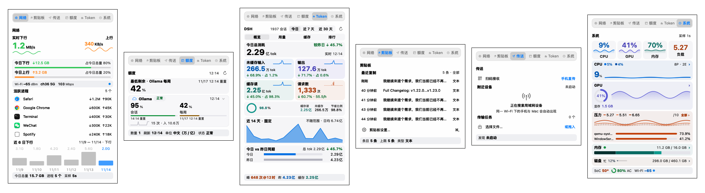

> 同一面板的六个标签页（离屏渲染，配色与布局同真机）：页头、卡片、页脚状态带全站统一，切页不换骨架。

## 为什么是「一览」

- **六个页面，一个面板。** 网络、剪贴板、传送、额度、Token、系统共用同一个浮窗与同一套版式，数字键 `1`–`6` 直达、`←`/`→` 循环切页。
- **菜单栏本身就是仪表盘。** 17 项指标可勾选：上下行、今日与本周流量、CPU / GPU / 内存 / 压力 / 磁盘 / 温度功耗 / Wi-Fi / 电量 / 负载、Token 今日与 7 天、缓存命中率。顺序可自定义（行尾上移下移 + 恢复默认）；默认只开上下行；密度三档、单行 / 两行 / 卡片布局、单位紧凑 / 全称都可切。
- **额度六个 provider 一屏比。** Ollama、Open Design、OpenCode Go、Claude、Codex、Cursor 同屏列出剩余与重置时刻，只显示「已启用且已配置」的；同一 provider 可配多个实例（多台 Ollama、多个账号）；凭据 AES-GCM 密文本机存储；锁屏 / 休眠自动暂停刷新；额度跌破、窗口重置、额度回升各有一类通知。
- **截图、贴图、剪贴板、互传是一套，不是四个工具。** 截完直接贴图或进剪贴板，剪贴板里的图可一键互传到手机。
- **本地优先。** 唯一的对外请求来自你配置的额度接口；无遥测、无自动更新、无后台上报；系统监控免 root，拿不到的指标显示「—」而不藏整张卡。

## 外观与渲染

- **三套主题，浅深各一套。** Apple（默认）、冷调石墨、暖调米白只换面系——面板底、卡片面、状态带底、轨道、分隔线、着色与玻璃配方；未缓存蓝 / 缓存读青绿 / 输出靛 / 请求橙这四族色和达标、告警等状态色三套共用，它们是数据含义，不随皮肤漂移。
- **玻璃拟态。** 面板在 macOS 26 及以上走系统 Liquid Glass（`NSGlassEffectView`），底下垫一层主题基色保证小字对比度；卡片不建额外合成层，用半透明底 + 顶部高光 + 半透明描边做出同样的层次。macOS 14 / 15 自动回落到 `NSVisualEffectView`，功能不减；实际观感随桌面壁纸与系统版本不同。
- **渲染三档。** 标准（默认）1 秒刷新 / 中频 5 秒 / 60 采样点；极致 0.5 秒 / 2 秒 / 120 点，并开启玻璃随动；省电 2 秒 / 15 秒 / 30 点，玻璃与动效关闭、图表降采样（排行 8→4 行），面板收起时整轮刷新停摆。
- 入口在「设置 → 外观」，改完即时生效，不用重启。

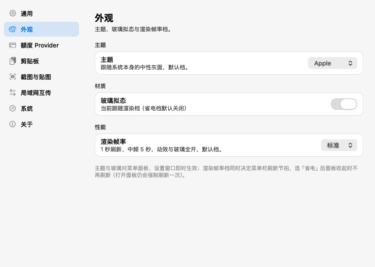

> 主题 / 玻璃拟态 / 渲染帧率三项都在这一页。图里的开关是离屏渲染画的，看不出 on 态；三项的实际取值与「偏好 vs 控件是否一致」记录在同目录[状态文本](docs/设计/外观-1.24/设置页-外观-状态文本.txt)里。

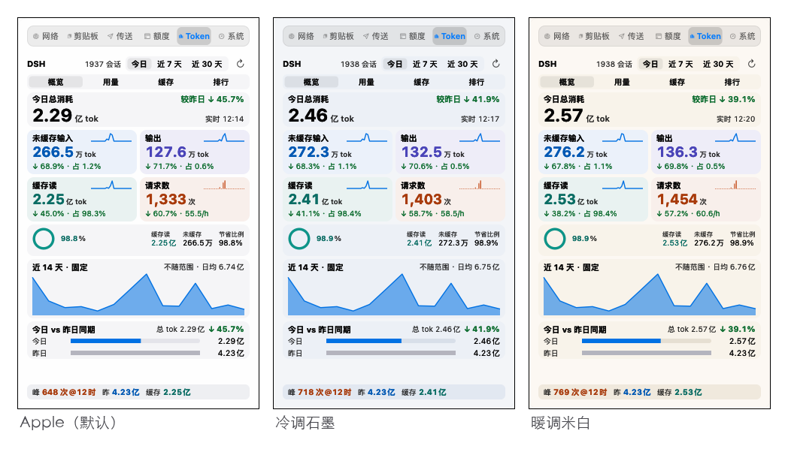

> 六页的深浅对照、三套主题各浅深一张，都在 [外观图集](docs/设计/外观-1.24/) 里；同目录还有一份[外观结构自证](docs/设计/外观-1.24/外观结构自证.txt)，记录玻璃层类型、圆角、基色层 alpha 与三档的 tick / 中频实测值。

## 通知与音效

- **七行事件表，一行一件事。** 额度提醒、额度重置、额度回升、截图完成、剪贴板动作、传输完成、面板展开收起；每行四个控件：开关、提示音、提醒方式、触控板手感。提醒类默认开、操作反馈类默认关。
- **额度提醒是两层。** 「通用 → 额度偏低提醒」与「额度 Provider → 窗口重置 / 额度回升 + 回升阈值」决定这件事**要不要发生**；「通知与音效」对应那三行决定**怎么提醒**（推送、声音、方式）。
- **提示音可以换成自己的。** 系统音效直接从 `/System/Library/Sounds` 读，不额外打包音频；上传 mp3 / m4a 会统一转成 AIFF，发送前同步到 `~/Library/Sounds` 并清理自己留下的旧副本。
- **提醒方式三档、手感四档。** 横幅+声音 / 仅横幅 / 仅通知中心；手感为关 / 轻 / 标准 / 有力——系统只提供三种反馈图案，所以这里没有「强度百分比」。横幅长什么样由系统设置决定。

## 一屏看全

| 模块 | 你能得到什么 |
|---|---|
| **网络** | 菜单栏实时上下行；今日上下行与占比；近 6 日趋势；活跃进程 Top 10；Wi-Fi 链路条（信号 / 信道 / 速率） |
| **额度** | 六个 provider 同屏（同一 provider 可多实例）；每个窗口的剩余百分比与重置时刻；点开看单 provider 明细 |
| **Token** | DSH 会话 token：今日 / 近 7 天 / 近 30 天；输入、输出、缓存读拆分；缓存命中率；项目与模型排行 |
| **剪贴板** | 历史卡片 + 模糊搜索 + 类型过滤；Paste Stack 顺序粘贴；图片原图落盘，删 / 清 / 超限都会回收磁盘 |
| **截图贴图** | `⌃⇧S` 截图 → 十种标注 → 复制 / 另存 / 快速保存 / 贴图置顶；工具条提示三档可配，快捷键可录制 |
| **互传** | 同一 Wi-Fi 发现设备，拖文件即发；手机扫码上传；断点续传；4 位 PIN 配对后免确认 |
| **系统** | CPU 每核 / GPU / 内存 / 压力 / 磁盘五张卡；整卡点进面板内二级详情；状态带含温度 / 电量 / 功耗 / Wi-Fi |

## 模块细节

### 网络

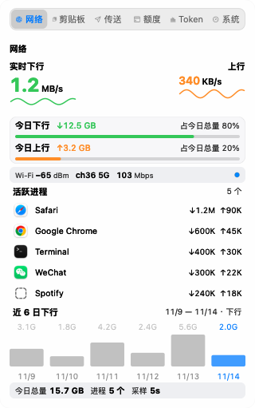

- 菜单栏与面板共用一次采样；进程按流量排序取 Top 10；Wi-Fi 链路条给出 RSSI、信道、速率与档位点，弱信号 / 断网降级成明确状态。

### 额度

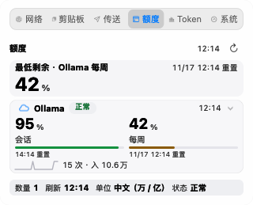

- 只列「已启用且已配置」的 provider，全都没配置时给空态 + 去配置入口，不摆假数据。
- 每行给窗口名（会话 / 每周 / 每月）、剩余百分比、重置时刻；点开看明细。
- 剩余跌破 5% / 4% / 3% / 2% / 1% 各提醒一次；锁屏或休眠时刷新暂停并在面板上显示暂停态。

### Token 用量

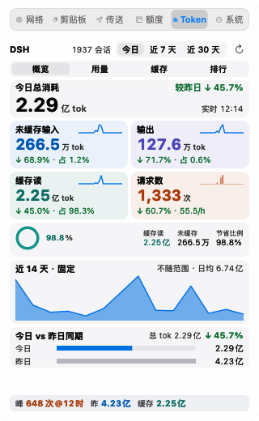

- 数据来源是本机 DSH 会话事件流，增量索引，内容不上传。
- 四屏：概览（四族卡 + 缓存命中条 + 近 14 天）、用量（主图 + 天趋势）、缓存（大环 + 四行拆分）、排行（项目 / 模型 Top 8）。
- 今日 / 7 天 / 30 天同源口径；同会话多版本文件按内容键去重；单桶 / 按小时 / 天趋势三个二级页点数据点即进。

### 剪贴板历史

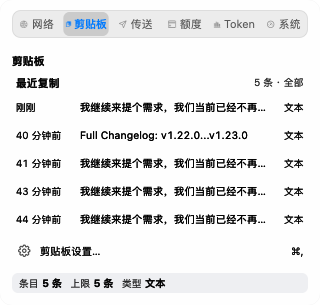

- 全局快捷键 `⌘⌥V`；`↑↓` 选择、`⌘` 粘贴、`⌘1`–`⌘9` 直选、`Esc` 收起，双击卡片也能粘。
- 模糊搜索与类型过滤；卡片悬停 0.45 秒出全文浮层。
- 图片按白名单采集、原图落盘；删除 / 清空 / 超限清理 / 启动清扫四处都会回收磁盘。
- Paste Stack 连续挑多条后按顺序粘贴；按 `?` 看十二键位帮助，首启有引导。

### 截图与贴图

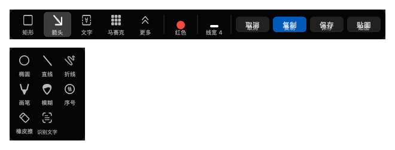

> 工具条与标注面板是浮在截图上的深色层，配色固定不跟随主题——压在任意内容上都要能读清。

- `⌃⇧S` 起手：窗口检测、放大镜、取色、历史选区。
- 十种标注：矩形 / 椭圆 / 直线 / 折线 / 箭头 / 画笔 / 马赛克 / 模糊 / 文字 / 橡皮，可撤销重做。
- 工具条默认只摆 4 个高频工具，其余收进「更多」；提示三档（仅图标 / 悬停气泡 / 常驻标签），设置页还能改位置、组显隐与顺序、常驻工具。
- `⌘C` 复制 / `⌘S` 另存 / `⌘⇧S` 快速保存 / `⌘T` 贴图；贴图窗可拖动、滚轮缩放、调透明度、旋转镜像、一键隐藏全部。

### 局域网互传

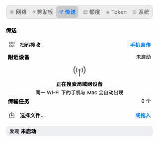

- 同一 Wi-Fi 自动发现；拖文件进投放区即发，支持多文件与断点续传。
- 手机 → Mac：面板「扫码接收」出二维码，手机扫码后在浏览器里选文件（10 分钟内有效）。
- 首次接收未配对设备需输 4 位 PIN，配对后免确认；接收完成可拖出为真实文件。

### 系统监控

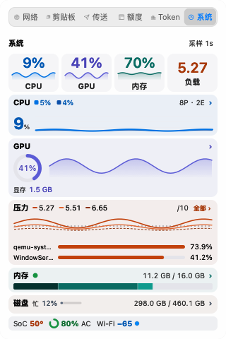

- 首屏五卡：CPU（用户 / 系统分段）、GPU（利用率 + 显存）、内存（四段堆叠 + 压力）、压力（Top 进程）、磁盘（读写 + IOPS）。
- 整卡点进二级页：CPU 每核热力、GPU 显存、内存四段、磁盘读写与 IOPS、压力 Top 10（CPU / 内存榜可切）。

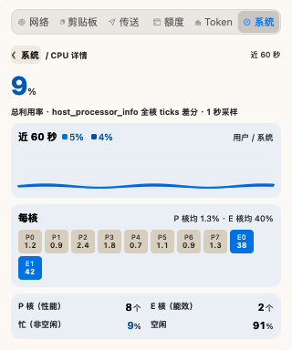

- 全部免 root 采样；某项在你机器上拿不到就显示「—」，不隐藏整张卡。

## 系统要求

- macOS 14 (Sonoma) 或更高
- Apple Silicon（ARM64）或 Intel（x86_64）：Release 两个架构各出一个包，按机器型号选
- 构建需要 Swift 6.3 及以上工具链（包清单 `swift-tools-version: 6.3`；本机实测 Swift 6.4 可编译，CI / 发版仍用 6.3；Swift 6 严格并发）

## 安装

### 方式一：下载 Release（推荐）

1. 打开 [Releases](https://github.com/baosfeng/toolbar/releases)，按架构下载：Apple Silicon 取 `Yilan-arm64.app.zip`，Intel 取 `Yilan-x86_64.app.zip`（型号看苹果菜单 →「关于本机」）。zip 名用英文只为下载链接干净，解压出来就是「一览.app」。
2. 解压后把 **「一览.app」** 拖进「应用程序」（完整路径 `/Applications/一览.app`）。包内的可执行文件仍叫 `NetworkMonitor`，所以活动监视器里看到的进程名是 NetworkMonitor。
3. 首次启动 **右键点图标 → 打开**（未公证，双击会被 Gatekeeper 拦）；仍被拦就去系统设置 → 隐私与安全性 → 「仍要打开」。
4. 启动后没有 Dock 图标、没有主窗口，菜单栏右侧出现网速数字，这就是它。

> 想开机自启：面板齿轮 →「开机自启动」，再按系统提示在「登录项」里允许。

### 方式二：从源码构建

```bash
git clone https://github.com/baosfeng/toolbar.git
cd toolbar/NetworkMonitor
./Scripts/build-app.sh release        # 编译 + 签名 + 部署到 /Applications 并启动

SKIP_INSTALL=1 ./Scripts/build-app.sh release        # 只出包，产物在 NetworkMonitor/dist/
ARCH=arm64 SKIP_INSTALL=1 ./Scripts/build-app.sh release   # 交叉构建另一架构
```

## 使用

左键单击菜单栏数字弹出面板；六个标签页（`1`–`6` 直达，`←`/`→` 循环）。右键菜单与面板齿轮里都有「设置…」（`⌘,`）和「退出」。

| 快捷键 | 作用 |
|---|---|
| `⌃⇧S` | 开始截图 |
| `⌘⌥V` | 唤起剪贴板面板 |
| `⌘,` | 打开设置 |
| `⌘T` | 贴图（截图工具条与贴图窗内） |

剪贴板与截图的快捷键都能在设置页重新录制，录完立即生效。设置窗口侧栏**九个分类**，顺序即展示顺序：**通用**（开机自启动、额度偏低提醒、数值单位、菜单栏指标与布局、面板分页显隐与排序）、**外观**（三套主题 / 玻璃拟态 / 渲染三档）、**额度 Provider**（启用、凭据、多实例、窗口重置与额度回升通知）、**剪贴板**、**截图与贴图**（含六个动作的快捷键录制）、**局域网互传**、**通知与音效**（七行事件表：开关 + 提示音 + 提醒方式 + 触控板手感，另有自定义音效库）、**系统**、**关于**，改完即时生效。

> 能力边界：横幅样式与是否弹横幅由系统设置决定，应用只组合「横幅 / 声音 / 通知中心」；触控板手感是系统 3 种反馈图案（关 / 轻 / 标准 / 有力四档），没有数值强度。

## 权限

| 权限 | 什么时候需要 | 不给会怎样 |
|---|---|---|
| 屏幕录制 | 截图、取色、窗口检测 | 截图不可用，会弹引导跳到系统设置 |
| 辅助功能 | 自动粘贴（模拟 `⌘V`）、部分快捷键 | 能记录剪贴板，但不能自动粘贴 |
| 输入监控 | 判断你是否活跃以调整剪贴板采集频率（只统计敲击次数） | 采集退化为固定低频 |
| 本地网络 | 局域网发现与文件互传 | 搜不到设备、扫码接收不可用 |
| 通知 | 额度提醒 / 重置 / 回升、传输完成（系统通知类事件） | 不弹系统通知；应用内提示音与触控手感仍可用 |

剪贴板读取本身不需要额外授权（macOS 15 起首次访问会提示一次）。系统设置路径：隐私与安全性 → 屏幕录制 / 辅助功能 / 输入监控 / 本地网络 / 通知。

## 数据与卸载

- 数据：`~/Library/Application Support/macMonitor/monitor.db`（SQLite，含剪贴板历史、流量与 Token 索引）
- 截图默认存 `~/Pictures/NetworkMonitor Snips`，互传接收默认在 `~/Downloads/局域网互传`
- 数据目录 `macMonitor` **不随包名变化**：从旧版 `NetworkMonitor.app` 升级到「一览.app」后历史数据与偏好原样继续用
- 卸载：先退出应用，删除 `/Applications/一览.app`（旧版是 `/Applications/NetworkMonitor.app`，升级时脚本会自动删掉旧包）；要清数据再删上面的 `macMonitor` 目录

## 常见问题

**进程名为什么叫「一览」？**
包名、菜单栏 / 通知 / 权限列表里的显示名、包内可执行文件（`Contents/MacOS/一览`）都是「一览」，所以活动监视器、`ps` 与崩溃报告里看到的进程名也是中文（崩溃报告文件名随之是 `一览-<时间>.ips`，历史 `.ips` 仍在原处）。构建产物仍叫 `NetworkMonitor`（SwiftPM target / 模块名不变），由 `build-app.sh` 在打包时复制改名为「一览」；bundle id `com.example.NetworkMonitor`、签名身份与数据目录 `macMonitor` 都不变——TCC 授权判据认 identifier + 签名证书、不认路径。改包名的唯一副作用是旧的登录项登记指向旧路径，应用启动时会自动重新登记（失败则把「开机自启动」开关回滚为关，不会显示虚假的已开启）。

**双击提示「无法验证开发者」？** 右键 → 打开；或系统设置 → 隐私与安全性 →「仍要打开」。

**菜单栏看不到图标？** 确认应用已启动（活动监视器里找「一览」，旧版是 NetworkMonitor）；若装了 Bartender 等工具，检查是否被折叠。

**`⌘⌥V` 没反应？** 先在剪贴板设置里确认快捷键没被占用，再检查辅助功能权限。

**传送搜不到设备？** 确认两台设备在同一 Wi-Fi、已允许「本地网络」；部分公共 Wi-Fi 会屏蔽设备互访。

## 开发

```bash
cd NetworkMonitor
swift build --disable-sandbox --build-system native           # 构建
swift run --disable-sandbox --build-system native TestRunner  # 测试（须显示「🎉 所有测试通过！」）
bash Scripts/check-file-size.sh                               # 大文件门禁
```

> 只装 Command Line Tools 的机器，默认构建后端会在会话初始化阶段失败，追加 `--build-system native` 即可；详见[踩坑记录](docs/踩坑/构建/swift-build-会话初始化失败.md)。CI 在 GitHub 托管的 macOS runner 上跑同样的构建、测试与门禁。

```
NetworkMonitor/
  Sources/
    NetworkMonitor/        # 可执行：菜单栏 UI、面板、剪贴板与互传
    NetworkMonitorCore/    # 库：协议、数据库、计费、传输协议（不依赖 AppKit）
    NetworkMonitorUI/      # 库：展示纯逻辑（单位排版、派生值）
    TestRunner/            # 可执行：手写断言测试
  Scripts/                 # 构建、打包、图标生成、大文件门禁
docs/                      # 设计规格、调研、踩坑记录
```

## 隐私

- 唯一的对外请求来自你配置的额度服务（Ollama / Open Design / OpenCode Go / Claude / Codex / Cursor），凭据由你本机输入并加密落盘
- 无遥测、无自动更新、无后台上报

## 贡献

- 提交前先读[构建与测试](docs/开发指南/构建与测试.md)与[提交规范](docs/开发指南/提交规范.md)
- 编码规范见 [.agents/skills/toolbar-coding-standards](.agents/skills/toolbar-coding-standards/SKILL.md)，文档导航见 [docs/索引.md](docs/索引.md)

## 许可证

[MIT](LICENSE)
