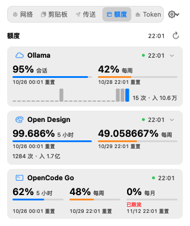
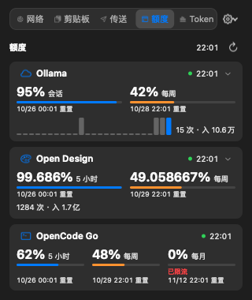

# OpenCode Go 额度监控设计规格

> **何时阅读：** 维护额度页第三个计费 provider（OpenCode Go）或调整 provider 刷新节流时。

## 背景与目标

额度页已有 Ollama、Open Design 两个 provider。本次新增 **OpenCode Go**（`opencode.ai` 的订阅制编码计划），
参考 Android 端 `OpencodeGoQuotaProvider` 的实现口径，复用既有 `BillingProvider` 注册表与聚合视图，不改面板结构。

目标：在菜单面板「额度」tab 里看到 OpenCode Go 的 5 小时 / 每周 / 每月三个剩余百分比窗口及重置时间，并参与阈值提醒。

## 接口事实（2026-10 调研，无真实 200 样本）

```
GET https://opencode.ai/zen/go/v1/usage
Authorization: Bearer sk-…            # Go API Key，与推理同一把
```

| 字段 | 含义 |
|------|------|
| `usage.rolling` / `.weekly` / `.monthly` | 滚动 5 小时 / 周 / 月三个窗口（旧版平铺在顶层） |
| `*.percent` | 0–100，**该窗口已用比例**（旧版键名 `usagePercent`） |
| `*.resetsAt` | RFC3339 重置时刻（旧版 `resetInSec` 相对秒数） |
| `*.status` | `ok`；`rate-limited` = 该窗口耗尽 |

- 字段结构来自官方 console 路由源码与第三方客户端交叉印证，**没有真实 key 的成功 200 响应** → 解析按推测实现并做防御性处理。
- `401` = Key 无效；`403` = Key 有效但无 Go 订阅；没有余额接口（`/zen/go/v1/balance` 等 404）。
- 官方未公布额度接口限流 → 刷新间隔给 5 分钟（Ollama 是 60 秒）。

## 设计决定

### 1. 额度映射：已用 → 剩余

接口给的是**已用**比例，App 内统一存**剩余**，转换在 provider 内完成：

| 字段 | 取值 |
|------|------|
| `id` | `window:rolling` / `window:weekly` / `window:monthly`（稳定，避免窗口顺序变化导致提醒状态错位） |
| `title` | 「5 小时」/「每周」/「每月」 |
| `remainingFraction` | `clamp(1 - percent / 100, 0, 1)`（接口偶发脏值，钳制到 0…1） |
| `resetsAt` | `resetsAt`（RFC3339）；旧形态 `resetInSec` 用注入的 `now` 换算成绝对时刻 |
| `badge` | `status == rate-limited` 时置「已限流」，且剩余强制为 0（让预警生效） |

`BillingBalance.included` / `purchasedUSD` 均为 nil → UI 只渲染限额行，无需新分支。

### 2. 只查额度、不查用量（`supportsUsage = false`）

该接口没有请求数 / token / 花费 / 按模型分组，因此：

- 协议新增能力位 `supportsUsage`（默认 `true`）；OpenCode Go 为 `false`。
- `BillingMonitor` 在 `supportsUsage == false` 时不发起用量请求（`ProviderFetchResult.usage` 为 nil），不会把 4xx 记成错误文案。
- 额度块收起态不显示用量摘要行、不显示展开箭头（没有可展开内容），整块高度比 Ollama 更紧凑。
- `fetchUsage` 仍必须实现，直接抛 `BillingError.invalidRequest`：调用方已按能力位短路，该分支只在误用时触发。

### 3. 每 provider 独立刷新节流

原实现是全局 60 秒节流，无法表达「OpenCode Go 少打接口」：

- 协议新增 `minimumRefreshInterval`（默认 0）；OpenCode Go = 300 秒。
- Core 新增纯函数 `BillingRefreshScheduler.isDue(now:lastAttempt:providerMinimum:force:)`，有效间隔 = `max(60, providerMinimum)`。
- `BillingMonitor` 把单一 `lastRefreshStarted` 换成 `lastAttempts[providerID]`，刷新时只对**到期**的 provider 发起请求；
  正在请求中的 provider 即使 `force` 也不重复打。
- 429 退避仍是全局的（一个 provider 撞限流时整体静默到 `Retry-After`，避免连环撞墙）。

### 4. 三窗口在双列额度格里的呈现

聚合视图原设计是双列额度格（会话 / 每周），OpenCode Go 有三个窗口：

- `BillingProviderBlockView` 的额度格按 `percentLimits.count` 动态建 1–3 列（`fillEqually`），三列时每列约 86pt。
- 一至两列（134pt / 278pt）角标同行：`已限流 · 10/26 08:00 重置`；
  三列窄格放不下（实测该串约 107pt > 86pt），角标独占一行、重置时间在下一行，且无角标的格也保留该行以对齐基线。
- 排版判定抽成 Core 纯函数 `BillingLimitLayout`（`maxColumns` / `isCompact(columnCount:)` / `inlineBadge`），
  TestRunner 无法 import 可执行 target，规则留在 UI 里就没有断言覆盖。
- 空数据 / 未配置时保持原有占位与配置入口。

### 5. 文案与错误

- `displayName = "OpenCode Go"`、`symbolName = "terminal"`、`credentialHint = "OpenCode Go API Key"`、
  `credentialPageURL = https://opencode.ai/`
- 401 → `BillingError.unauthorized`（统一文案「凭据无效或已过期，请重新填写」）
- 403 → `.forbidden("该 Key 没有 OpenCode Go 订阅")`，把官方 `OpenCode Go subscription required.` 翻成可照做的中文
- 429 → `.rateLimited(retryAfter:)`；5xx → `.serviceUnavailable`；解析失败 → `.invalidResponse`

## 落点

| 文件 | 变更 |
|------|------|
| `Sources/NetworkMonitorCore/Billing/BillingProvider.swift` | 协议增 `supportsUsage` / `minimumRefreshInterval`（带默认实现） |
| `Sources/NetworkMonitorCore/Billing/BillingModels.swift` | `BillingPercentLimit` 增 `badge` |
| `Sources/NetworkMonitorCore/Billing/BillingRefreshScheduler.swift` | 新增：每 provider 节流纯函数 |
| `Sources/NetworkMonitorCore/Billing/OpencodeGoBillingProvider.swift` | 新增 provider（额度查询 / 错误映射 / 解码） |
| `Sources/NetworkMonitorCore/Billing/OpencodeGoBillingDTOs.swift` | 新增响应 DTO（新旧字段名兼容） |
| `Sources/NetworkMonitorCore/Billing/BillingLimitLayout.swift` | 新增：额度格 1–3 列排版规则纯函数 |
| `Sources/NetworkMonitorCore/Billing/BillingCredentialStore.swift` | 环境变量键按 provider 解析（连字符转下划线，`BILLING_OPENCODE_GO_API_KEY` 可 export） |
| `Sources/NetworkMonitor/Billing/BillingMonitor.swift`、`BillingMonitor+Fetching.swift` | per-provider 节流、按能力位跳过用量 |
| `Sources/NetworkMonitor/Billing/BillingMonitorSnapshot.swift` | `ProviderDescriptor` 增 `supportsUsage`；用量结果改为可选 |
| `Sources/NetworkMonitor/MenuPanel/BillingProviderBlockView.swift`、`BillingProviderBlockView+QuotaRows.swift`、`BillingLimitCellView.swift` | 额度格 1–3 列自适应、角标、无用量收起态 |
| `Sources/NetworkMonitor/MenuPanel/BillingPanePreview.swift`、`Debug/MenuPanelSnapshot.swift`、`Debug/MenuPanelSnapshot+CreditsStates.swift` | 快照示意块与截图入口（档位定义拆出） |
| `Sources/NetworkMonitor/AppCoordinator.swift`、`AppCoordinator+Transfer.swift` | 注册 `OpencodeGoBillingProvider`；顺带把互传装配拆出以回到单文件上限内 |
| `Sources/TestRunner/OpencodeGoBillingTests.swift`、`BillingTests.swift` | 新增解码 / 换算 / 错误映射 / 节流测试 |

## 实机预览

| 浅色 | 深色 |
|---|---|
|  |  |

三窗口并排、每月窗口带「已限流」角标；该块没有摘要行与展开箭头（没有用量接口）。

## 验收

- `swift build --disable-sandbox --build-system native` 通过；
- `swift run --disable-sandbox --build-system native TestRunner` 输出「🎉 所有测试通过！」；
- 快照模式（`NM_SNAPSHOT_DIR`）产出 `menu-credits-opencode-go-{light,dark}.png`：三窗口并排、无用量摘要行、无展开箭头；上方预览即该产物；
- 真实 key 手工验证：三个窗口的剩余百分比与 `opencode.ai` 控制台一致（无 key 时只验证 401/403 分支）。

## 已知限制

- 没有真实 200 响应样本，字段名按推测 + 新旧双兼容实现，接口改形态只会退化为「响应解析失败」而不是崩溃；
- 没有用量明细，因此没有请求数 / token / 花费 / 按模型统计；
- 没有余额接口，无法展示剩余美元额度；
- 5 分钟刷新是保守估计，官方若公布限流口径可再收紧。