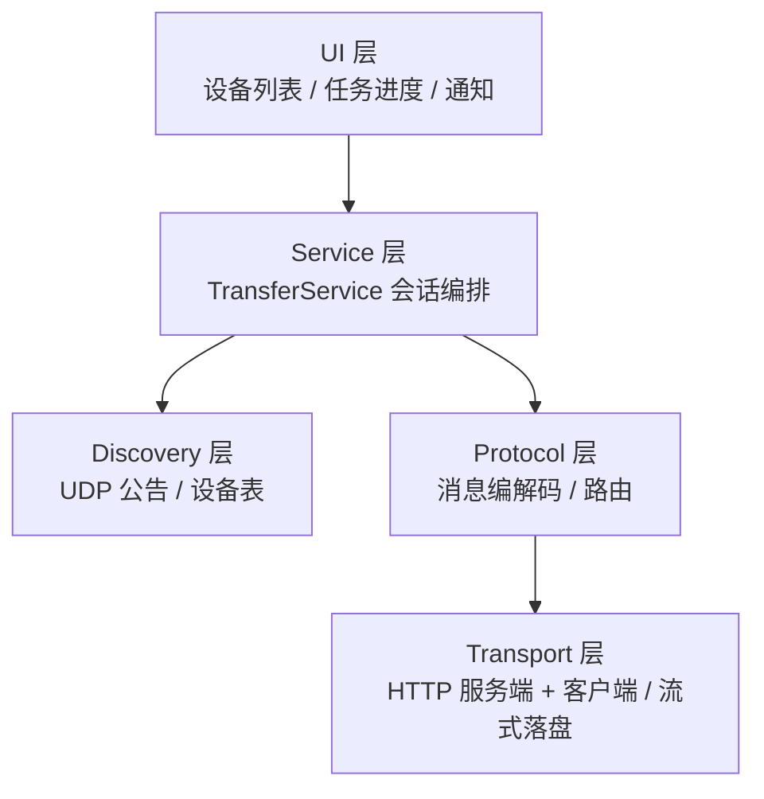

# 局域网文件互传 设计规格

> 状态：待确认｜日期：2026-10-18｜涉及仓库：`toolbar`（Mac 端）+ `android-monitor`（Android 端）
> 相关：[调研结论](#12-调研结论) · [剪贴板历史设计](剪贴板历史-设计规格.md)（同项目的面板与分层惯例）

## 1. 目标与范围

**目标**：同一局域网内，Mac 菜单栏 App 与 Android App 之间自动发现彼此并双向传文件，不需要输入 IP、不需要公网、不经过第三方服务器。

**本期包含**：设备自动发现、双向传输、多文件、断点续传、进度显示、PIN 配对一次后免确认。

**本期不做**：跨网段/公网中继、文本与剪贴板互通、Windows 客户端、LocalSend 协议互通（架构预留，见 [3.6](#36-可替换点)）。

**硬约束**（沿用两个仓库现状）：
- 两端零第三方业务依赖：Mac 用 `Network.framework` + `URLSession`；Android 用 `ServerSocket` + `HttpURLConnection` + `org.json` + `MulticastSocket`
- Mac 单文件 ≤500 行 / 15 KiB；注释中文；Android 遵守 `checkUiStyle` 与 `checkTodos` 门禁

## 2. 架构分层

两端对称四层，依赖方向自上而下，下层不感知上层：



| 层 | 职责 | 不做什么 |
|---|---|---|
| Discovery | UDP 组播/广播收发、设备表维护、离线判定、扫描兜底 | 不碰文件、不建 TCP |
| Protocol | JSON 消息结构、路由分发、错误码、鉴权标记解析 | 不写磁盘、不管线程模型 |
| Transport | HTTP/1.1 解析与响应、流式读写、Range/offset、sha256 计算 | 不决定业务规则（谁授权、存哪） |
| Service | 会话状态机、配对记忆、目录选择、进度广播 | 不解析 HTTP |

## 3. 协议规范（两端唯一真相）

### 3.1 端口与地址

| 用途 | 端口 | 说明 |
|---|---|---|
| UDP 发现 | `53318` | 组播组 `239.255.77.77` + 广播 `255.255.255.255` |
| HTTP 传输 | `53319` | 被占用时顺延 `53320`–`53328`，实际端口随公告上报 |

### 3.2 发现消息

三个 `type`，字段集一致（`discover` 可只带 `v/type`）：

```json
{
  "v": 1,
  "type": "announce",
  "deviceId": "and-7f3a9c",
  "alias": "小米14",
  "deviceType": "android",
  "port": 53319,
  "proto": "http",
  "caps": ["send", "recv"],
  "appVersion": "1.0.0",
  "ts": 1760000000
}
```

`type` 语义：`announce` 周期公告；`discover` 主动查询；`offer` 对 `discover` 的单播应答（内容同 `announce`）。

**节奏**：启动连发 3 次（间隔 500ms）→ 每 5s 一次心跳；收到 `discover` 立即单播 `offer`（同一 IP 2s 内只回一次）；15s 未收到公告标记离线，60s 未收到则从列表移除。

**兜底顺序**（前一级失败或用户手动刷新时逐级降级）：
1. 组播 `239.255.77.77:53318`
2. 广播 `255.255.255.255:53318`
3. 对本机 `/24` 网段逐 IP 单播 `discover`（并发 128、单 IP 超时 300ms）

**平台差异**：Android 侧必须持 `WifiManager.MulticastLock`，否则多数 ROM 上收不到组播；Mac 侧需在 Info.plist 声明 `NSLocalNetworkUsageDescription`（首启会弹一次本地网络授权）。

### 3.3 传输路由

统一前缀 `http://<ip>:<port>/api/v1/`，响应体沿用 Android 现有约定 `{code, message, data}`。

| 路由 | 方法 | 用途 |
|---|---|---|
| `/info` | GET | 设备信息与能力，发现层异常时用于确认对端 |
| `/offer` | POST | 提交文件清单，建立会话 |
| `/offer/status` | GET | 查询会话确认状态（`session` 参数） |
| `/upload` | PUT | 单文件二进制流上传（`session`、`file`、`offset` 参数） |
| `/cancel` | POST | 中止会话（`session` 参数） |

**`POST /offer` 请求体**

```json
{
  "senderDeviceId": "mac-3b1e",
  "senderAlias": "bsfeng 的 MacBook Pro",
  "sessionId": "<可选：重提 PIN 时携带上次返回的 sessionId>",
  "pin": "<可选：配对码，四位数字>",
  "files": [
    { "fileId": "f1", "name": "照片.jpg", "size": 4123456,
      "sha256": "<hex>", "mime": "image/jpeg" }
  ]
}
```

**响应**：`data = { sessionId, token, state, accepted[], pairingKey? }`

- `state = "approved"`：已配对设备或用户已确认，`accepted` 含每个文件的 `{fileId, offset}`（新文件 `offset=0`，可续传时大于 0）
- `state = "pending"`：未配对，接收端已弹出 PIN 确认；`token` 照常返回，`accepted` 为空数组，客户端转轮询 `/offer/status`
- `state = "denied"`：用户拒绝（错误码 `4006`）
- `pairingKey`：**可选**，仅当本次 offer 完成新配对（PIN 校验通过）时出现，32 字节小写 hex。由接收端生成，发送端收到后按 `peerDeviceId` 持久化，后续请求带 `X-Pair-Key` 免确认。已配对设备重新 offer 时不返回该字段。

**会话复用**：重提 PIN 时发送端应在 body 带 `sessionId`；接收端若未收到，按 `senderDeviceId + files 的 sha256 集合` 复用其待确认会话，避免重复建立。

**鉴权分工**：`X-Pair-Key` 用于「这台设备是否已与我配对、可否免确认」，只在 `POST /offer` 上校验；`token` 用于「本次会话能否上传」，只在 `PUT /upload` 上校验。两者不互相替代。

**`GET /offer/status?session=`** → `data = { state }`，取值 `pending / approved / denied / expired`

**`PUT /upload?session=&file=&offset=`**
- 请求头：`X-Transfer-Token: <offer 返回的 token>`、`Content-Type: application/octet-stream`
- 请求体：从 `offset` 起的裸字节流，不包 multipart
- 成功响应：`data = { fileId, received, sha256 }`
- 校验失败返回 `4005`，接收端删除该文件 `.part`

**`POST /cancel?session=`**：双方任一方可调用，接收端删除全部 `.part`

### 3.4 错误码

| code | 含义 |
|---|---|
| 0 | 成功 |
| 4000 | 未分类 / 未知路由（HTTP 404 时携带） |
| 4001 | token 缺失或不匹配 |
| 4002 | 会话不存在或已过期 |
| 4003 | offset 与已收字节不匹配 |
| 4004 | 接收端磁盘空间不足 |
| 4005 | sha256 校验失败 |
| 4006 | 用户拒绝 |
| 4007 | 确认超时（默认 30s）|

**offset 契约（两端必须一致）**
- `PUT /upload` 的 `offset` **必须等于接收端 `.part` 当前字节数**，不等返回 `4003`，不截断、不猜测
- 因此**发送端重试不能把 offset 归零**：断过续的上传要带 `sessionId` 重新 `POST /offer`，用返回的 `accepted[].offset` 作为新起点
- `POST /offer` 的 `accepted[].offset` 由 `.part` 实际大小回填；`.part` 不存在时为 0

### 3.5 配对与鉴权

- 未配对时，`POST /offer`（无 `X-Pair-Key`）返回 `state=pending`，接收端 UI 展示 4 位 PIN 与文件清单；发送端在自身 UI 输入 PIN 后**带着 `pin` 字段与上次的 `sessionId` 重新 `POST /offer`**
- **`pairingKey` 由接收端生成、经 `/offer` 响应下发给发送端**，双方各自按 `deviceId` 持久化；此后 `POST /offer` 带 `X-Pair-Key`，接收端校验通过直接 `approved`，不再弹窗
- 配对记录可在设置里移除；移除后回到 PIN 流程
- `pairingKey` 只用于配对判断，不参与传输鉴权——传输始终走 `/offer` 下发的 `token`

### 3.6 接收端本地策略（免确认规则）

以下是**接收端单方面**的放行策略，不改变协议字段；发送端无需感知，只看返回的 `state`。

| 策略 | 触发条件 | 行为 |
|---|---|---|
| 已配对 | 请求带 `X-Pair-Key` 且与本地记录一致 | `approved` |
| 免配对窗口 | 设置里开关开启，且距开启时长未超过所选时长（5 / 10 / 30 分钟） | `approved`，不生成 PIN |
| 体积阈值 | 设置里开启，且本次 offer 的**文件总大小 ≤ 阈值** | `approved`，不生成 PIN |
| 默认 | 以上都不满足 | `pending` + 生成 PIN，等待输入（60s 超时 `4007`） |

- 三条放行策略是 **OR** 关系，任一满足即免确认
- 体积阈值默认关闭（0 = 一律需要 PIN）
- 免配对窗口到期后自动回到默认策略，界面展示剩余时间
- 放行时**不返回 `pairingKey`**——免确认不等于建立长期配对

### 3.7 可替换点

| 想换什么 | 动哪里 |
|---|---|
| 发现协议（改 mDNS / 二维码） | `Discovery` 层实现，协议层不变 |
| 传输通道（改 WebSocket / QUIC） | `Transport` 层实现，`Protocol` 只依赖 `HttpRequest/HttpResponse` 抽象 |
| 兼容 LocalSend | 新增一套 `Protocol` 实现，映射到同一 `TransferSession` |

## 4. 数据模型

两端结构对齐（Mac 用 `struct`，Android 用 `data class`）：

```kotlin
RemoteDevice(deviceId, alias, deviceType, ip, port, appVersion, lastSeenAt, isPaired, isOnline)

TransferSession(id, direction /* send|recv */, peerDeviceId, files, state, createdAt)
TransferFile(fileId, name, size, sha256, mime, offset, transferred)

TransferState = Pending → Offering → AwaitingConfirm → Transferring → Verifying → Completed
                                                                         ↘ Failed / Cancelled
```

`TransferState` 迁移必须集中在一处（Mac：`TransferSessionMachine`；Android：`TransferSessionMachine`），便于单测穷举非法迁移。

## 5. 收件与文件落盘

| 端 | 默认目录 | 写入方式 |
|---|---|---|
| Mac | `~/Downloads/局域网互传/` | `FileHandle` 流式追加 |
| Android | `Downloads/局域网互传/` | `MediaStore.Downloads` + `RELATIVE_PATH`（`minSdk 29` 原生支持）|

规则：
- 传输中写 `<fileId>.part`，完成后校验 sha256 再改名为正式名
- 同名文件追加 ` (1)`、` (2)`，在 `accept` 阶段确定最终名，避免中途改名
- 收到 `offer` 前预检磁盘可用空间，不足直接返回 `4004`
- 缓冲区 64 KiB，内存占用与文件大小无关

## 6. 错误处理与取消

| 场景 | 行为 |
|---|---|
| 传输中断网 | 客户端重试 3 次（1s/2s/4s 退避），仍失败则会话转 `Failed`，`.part` 保留供下次续传 |
| 60s 无字节进展 | 判定超时，双方各自清理连接，任务转 `Failed` |
| 接收端空间不足 | 立即返回 `4004`，发送端提示具体缺口 |
| 用户取消 | 调用 `/cancel`，双方清理 `.part` 与临时状态 |
| App 退出 | Android 前台服务存活时任务继续；服务被系统杀死后任务转 `Failed`，`.part` 保留 |

## 7. 动效与音效

### 7.1 动效原则

- **复用既有 token**：时长与曲线一律取 `DesignTokenTable` 的 `dur-*` / `ease-*`，不新增魔数
- **只表达状态变化**：不加装饰性动画；传输中唯一需要持续动的是进度条
- **无障碍兜底**：系统「减弱动态效果」或「动画时长缩放 = 0」时，所有动效直接落到终态（复用 `rememberMotionEnabled`）

### 7.2 传输场景动效表

| 触发 | 动效 | 时长 | 曲线 | 出处 token |
|---|---|---|---|---|
| 设备出现在列表 | 淡入 + 上移 10px，逐项延迟 | 340ms / 每项 +24ms | ease-out | `dur-page` `stagger` |
| 设备掉线 | 透明度 → 0.4，状态点转灰 | 120ms | ease-standard | `dur-state` |
| 任务卡片新增 | 高度展开 + 淡入 | 340ms | ease-out | `dur-page` |
| 进度推进 | 进度条宽度插值，数字等宽不抖动 | 120ms | ease-standard | `dur-state` |
| 速度数字 | 数字滚动到新值 | 600ms | ease-out | `dur-chart` |
| 传输完成 | 进度条填满 → 对勾弹入 → 卡片转成功色 | 220ms | ease-spring | `dur-overlay-in` `ease-spring` |
| 传输失败 | 卡片横向抖动 ±4px 三次 → 转错误色 | 300ms | ease-in | `ease-in` |
| 配对弹窗 | 淡入 + 缩放 0.96→1；关闭 150ms | 220ms / 150ms | ease-out | `dur-overlay-in/out` |
| PIN 每位填入 | 数字 scale 0.9→1 | 120ms | ease-spring | `dur-press` |
| 按钮按下 | scale 0.96 | 120ms | ease-standard | `dur-press` |
| 拖拽悬停 | 虚线框变色 + 整块缩放 1.02 | 120ms | ease-standard | `dur-state` |

Mac 端没有 Compose 的 token 体系，对应取系统惯例：状态类 0.12s、展开类 0.34s、弹层 0.22s，曲线用 `CAMediaTimingFunction(name: .easeOut)`，并遵循系统「减弱动态效果」开关。

### 7.3 音效设计

原则：**默认只开「传输完成」一种**，其余默认关闭；全部可在设置里逐项关闭；不覆盖系统静音。

| 事件 | 音色 | 时长 | Mac（`NSSound` 系统音） | Android（零依赖） |
|---|---|---|---|---|
| 接收完成 | 轻快三音上行 | ~300ms | `Glass` | 系统通知音（`RingtoneManager.TYPE_NOTIFICATION`） |
| 发送完成 | 单音下行 | ~250ms | `Tink` | 系统通知音（另一条） |
| 传输失败 | 低沉两音下行 | ~400ms | `Basso` | `ToneGenerator.TONE_PROP_NACK` |
| 新设备出现（默认关） | 极轻提示 | ~150ms | `Pop` | 仅震动 `CONFIRM` |
| 配对码生成（默认关） | 单音 | ~200ms | `Morse` | 仅震动 |

**实现约束**
- 两端都不打包音频资源：Mac 走 `/System/Library/Sounds` 的系统音，Android 走系统通知音 + `ToneGenerator`
- 触觉跟音效配对：完成用 `HapticFeedbackConstants.CONFIRM`，失败用 `REJECT`
- 同一事件 500ms 内去重——多文件连续完成时不要连响

### 7.4 两端一致性

「完成」的视觉节奏（对勾 220ms）与音效在两端取同一个值。同一次传输在两台设备上几乎同时结束，节奏不同步会让人觉得"没传完"或"多传了一次"。

## 8. 文件清单与落点

### 7.1 Mac 端（`toolbar`）

**Core 新增**（`Sources/NetworkMonitorCore/Transfer/`）：

1. `Discovery/DiscoveryMessage.swift` — 消息结构、编解码、版本兼容
2. `Discovery/UdpDiscoveryService.swift` — 组播/广播收发、心跳、离线判定
3. `Discovery/DeviceRegistry.swift` — 设备表与状态变更事件
4. `Protocol/TransferProtocol.swift` — 路由常量、错误码、请求/响应模型
5. `Protocol/TransferRouter.swift` — 路由分发到 Service
6. `Transport/HttpRequestParser.swift` — 请求行、头部、查询参数解析
7. `Transport/HttpResponseWriter.swift` — 响应构造与流式写入
8. `Transport/HttpServer.swift` — `NWListener` 生命周期、每连接一请求
9. `Transport/FileStreamReader.swift` / `FileStreamWriter.swift` — 流式读写与 sha256
10. `Service/TransferSessionMachine.swift` — 状态机
11. `Service/TransferService.swift` — 会话编排、收件目录、配对记忆

**App 新增**（`Sources/NetworkMonitor/Transfer/`）：

12. `TransferPaneView.swift` — 面板：设备列表、拖拽区、任务进度
13. `TransferController.swift` — 面板与 Service 接线
14. `TransferNotification.swift` — 完成/失败通知
15. `TransferPairingSheet.swift` — PIN 输入与展示

**改动点**：`MenuTabBarView` 加第 4 个 tab「传送」；`AppCoordinator` 装配；`build-app.sh` 的 Info.plist 加 `NSLocalNetworkUsageDescription`；`NetworkMonitor.entitlements` 视沙盒开关补 `com.apple.security.network.server`。

### 7.2 Android 端（`android-monitor`）

1. `domain/.../domain/transfer/TransferModels.kt` — 会话/文件/状态枚举（纯 Kotlin）
2. `app/.../transfer/discovery/DiscoveryMessage.kt` — `org.json` 编解码
3. `app/.../transfer/discovery/UdpDiscoveryService.kt` — `MulticastSocket` + `MulticastLock`
4. `app/.../transfer/discovery/DeviceRegistry.kt`
5. `app/.../transfer/transport/MiniHttpServer.kt` — `ServerSocket` + 请求解析
6. `app/.../transfer/transport/MiniHttpClient.kt` — `HttpURLConnection` 封装
7. `app/.../transfer/transport/StreamCopier.kt` — 流式落盘 + sha256
8. `app/.../transfer/service/TransferService.kt` — 前台服务（端口常驻）
9. `app/.../transfer/service/TransferSessionMachine.kt`
10. `app/.../transfer/ui/TransferScreen.kt` + `TransferViewModel.kt`

**改动点**：`AndroidManifest.xml` 加 `FOREGROUND_SERVICE`、`FOREGROUND_SERVICE_DATA_SYNC` 与 `<service>` 声明；`MainActivity` 加第 5 个 Tab；分享菜单 `ACTION_SEND` 接收入口；首次启动请求 `POST_NOTIFICATIONS`。

## 9. 测试

| 端 | 用例 |
|---|---|
| Mac `TestRunner` | 发现消息编解码与版本兼容、设备离线判定、状态机非法迁移、文件名去重、offset 校验、`/24` 扫描地址生成 |
| Android JUnit | 同上的纯逻辑用例（放 `domain` 模块最省事）；`MiniHttpServer` 用假 socket 回环验证请求解析 |
| 联调 | 两端未接 UI 时先用 `curl` 手工打 `/offer` + `/upload`，验证协议与断点 |

禁止以「跑起来看着正常」代替断言；每个协议字段至少一条编解码用例。

## 10. 里程碑

| 阶段 | 交付 | 工期 |
|---|---|---|
| M1 | 发现打通：两端设备列表互相可见（含组播锁、Mac 权限弹窗实测） | 2d |
| M2 | Android → Mac 单文件传输 + 进度 + 收件目录 | 2d |
| M3 | Mac → Android + 多文件 + 断点续传 | 2d |
| M4 | 体验：拖拽、通知栏进度、历史、PIN 配对记忆 | 2d |

## 11. 风险

| 风险 | 影响 | 应对 |
|---|---|---|
| Mac 本地网络权限静默失败 | 发现层完全不可用 | M1 第一天实测纯 UDP 监听是否触发授权；缺声明时给明确诊断而不是空列表 |
| Android 厂商省电策略杀前台服务 | 收不到文件 | 引导加入后台白名单；服务被回收后任务标记失败并保留 `.part` |
| 组播被企业/访客网络隔离 | 只看到空列表 | 广播与 `/24` 单播兜底，面板提供「手动刷新」与手动 IP 输入 |
| 两端协议漂移 | 联调反复 | 本文件为唯一真相，改动先改本文件再改两端 |

## 12. 调研结论

- **AirDrop 不可用**：仅跑在 AWDL 上，无公开 API/CLI，跨平台无解
- **LocalSend** 是同类里最成熟的参考：UDP 组播 `224.0.0.167:53317` 公告 + HTTP 四路由，但无应用层断点续传、依赖自签 HTTPS；本设计只在发现节奏与路由形态上借鉴，不复用其协议
- **mDNS/Bonjour** 未作为主发现手段：Android `NsdManager` 在国内 ROM 上注册不稳定，且 Mac 侧同样要本地网络权限
- **PairDrop/Syncthing** 不适配：前者依赖常驻信令与浏览器内存模型，后者是持续同步而非单次投递
