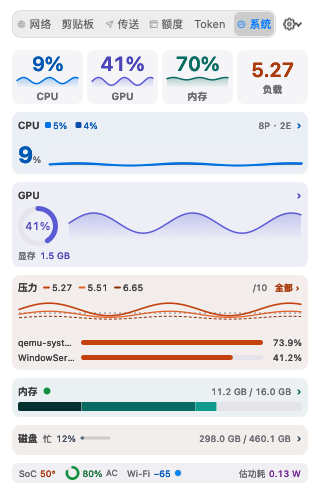
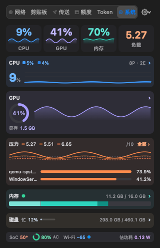
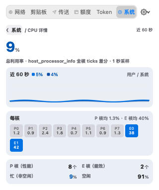
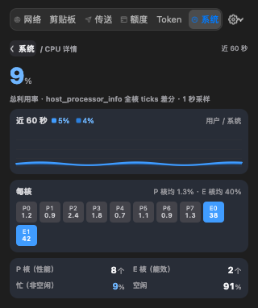
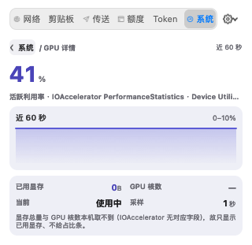
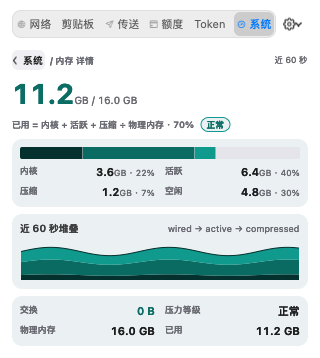
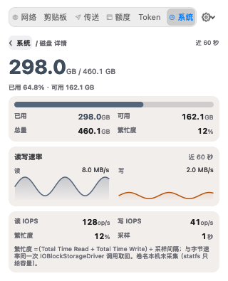
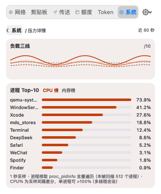

# 系统页 v2：配色与二级详情页设计决策

> 何时阅读：维护菜单面板「系统」页的配色、首屏结构、五张卡的二级详情页，或需要追溯 v2 定稿依据时。
> 上游实现口径（采样、字段、降级矩阵）见 [系统监控-设计规格.md](../系统监控-设计规格.md)；本文只记录**设计决策与定稿值**。

## 1. 定稿结论

定稿 = **A · 语义分族** 骨架 + **B · 冷调层次** 手法 + **C · 暖冷平衡**（橙作次级）：

- **A 语义分族**：一卡一族——CPU 蓝 / GPU 靛 / 内存 青绿 / 压力 橙 / 磁盘 石墨；状态带四段各一色。先保「一卡一族」的识别速度。
- **B 冷调层次**：图表用同族纵向渐变（顶部浓 → 底部透明）、卡片 3–5% 语义 wash、轨道分两档、字号/字重分层；用层次替代更多色相。
- **C 暖冷平衡**：橙只承担「压力（就绪队列）」与「磁盘写（次级序列）」；温度是唯一真暖状态色，避免橙变成第二个族色。

首屏采用**版2 紧凑形态**（实现态 495pt ≤ 520pt，一屏含状态带），所有下沉信息都能点卡进入面板内二级详情页取回（见第 4、5 节）。

## 2. 定稿色板

单一色值来源：Core 的 `SystemPaletteTokens`（49 个语义 token × 浅/深写死 sRGB）。**禁止用 `controlAccentColor` 混色**：v3 在 oklab 里把电池绿与强调蓝插值，hue 被拖到 178°（青）。

### 2.1 底 / 轨道 / 文字

| token | 用途 | 浅色 | 深色 | 对比度（浅 / 深） |
|---|---|---|---|---|
| `--bg` | 面板底 | #FFFFFF | #1A1A1C | 非文字 |
| `--surface` | 四联格 / 背钮底 | #F5F5F7 | #242427 | 非文字 |
| `--band` | 状态带底 | #F0F0F4 | #2B2B30 | 非文字 |
| `--card-cpu` | CPU 卡 wash（4.5% / 6%） | #EAEFF6 | #282D37 | 非文字 |
| `--card-gpu` | GPU 卡 wash | #EEEFF6 | #2E2D37 | 非文字 |
| `--card-mem` | 内存卡 wash | #EBF1F2 | #263033 | 非文字 |
| `--card-load` | 压力卡 wash | #F3EDEC | #332C2C | 非文字 |
| `--card-disk` | 磁盘卡 wash | #F2EEEC | #322F2B | 非文字 |
| `--track` | 轨道底 | #E4E4EA | #39393F | 非文字 |
| `--track-2` | 轨道第二档（热力格底 / 繁忙条底） | #D6D6DE | #43434A | 非文字 |
| `--grid` | 图表参考线 | #ECECF1 | #34343A | 非文字 |
| `--tab-on-bg` / `--tab-on-ink` | 选中 tab 底 / 字 | #D5E4F4 / #0058B3 | #2A3E57 / #6FB6FF | 5.33 / 5.10（字） |
| `--fg` | 主文字 | #1D1D1F | #F5F5F7 | 16.83 / 15.96 |
| `--fg-2` | 次级文字 / 数值 | #3D3D40 | #D6D6DA | 9.94 / 10.40 |
| `--muted` | 弱文字 | #62626A | #A8A8AE | 5.55 / 6.37 |
| `--meta` | 元信息 / 单位 / 标签 | #6A6A72 | #98989D | 4.92 / 5.25 |

`meta` 落在五张卡 wash 上时余量最小的是压力卡橙 wash：**浅 4.63:1 / 深 4.76:1**（已写进对比度测试与实现规格的脚注口径）。

### 2.2 语义族与状态带

| token | 用途 | 浅色 | 对比 | 深色 | 对比 |
|---|---|---|---|---|---|
| `--m-cpu` / `--m-cpu-2` | CPU 面积 / 用户态；系统态带 / E 核 | #0071E3 / #0A4EA8 | 4.07 / 6.81（图形） | #409CFF / #2B7FDD | 4.88 / 3.41 |
| `--m-cpu-ink` | CPU 数值 / 图例文字 | #0058B3 | 5.97（字） | #6FB6FF | 6.45 |
| `--m-gpu` | GPU 环 / 折线 | #5B5BD6 | 4.65（图形） | #A89DFF | 5.77 |
| `--m-gpu-ink` | GPU 数值 | #4A44B8 | 6.48（字） | #BFB6FF | 7.34 |
| `--m-mem-1/2/3` | 内存 wired / active / compressed | #04302D / #0A6B62 / #0F9A8D | 12.55 / 5.59 / 3.05（图形） | #7CE3D8 / #2DD4BF / #0F8F83 | 8.91 / 7.26 / 3.40 |
| `--m-mem-ink` | 内存数值 / 交换 / 徽标字 | #0B6D64 | 5.43（字） | #5CE3D2 | 8.61 |
| `--m-load-1/2/3` | 负载 1 / 5 / 15 分钟线 | #C2410C / #E0632C / #8A2F08 | 4.47 / 3.03 / 7.28（图形） | #FF8A4C / #C9682F / #E8734A | 5.85 / 3.58 / 4.54 |
| `--m-load-ref` | 核数参考虚线 | #7F7F88 | 3.43（图形） | #7D7D86 | 3.35 |
| `--m-proc` | 进程榜条 | #C2410C | 4.47（图形） | #FF8A4C | 5.85 |
| `--m-load-ink` | 压力数值 / 「全部」 | #A83A0B | 5.54（字） | #FFAB7D | 7.40 |
| `--m-disk` / `--m-disk-read` | 磁盘忙条 / 容量 / 读序列（石墨） | #55657A | 5.16（图形） | #A9B8CC | 6.60 |
| `--m-disk-write` | 磁盘写序列（琥珀＝次级） | #B45309 | 4.36（图形） | #F5B942 | 7.55 |
| `--m-disk-ink` | 磁盘数值 | #3F4C5C | 7.59（字） | #C8D4E4 | 8.87 |
| `--m-temp` / `--m-temp-ink` | SoC 温度图标 / 读数 | #D9480F / #A83509 | 3.78（图形）/ 5.81（字） | #FF6B42 / #FFA184 | 4.99 / 7.17 |
| `--m-bat` / `--m-bat-ink` | 电池环 / 电量读数 | #14913F / #116F33 | 3.59 / 5.52 | #34D399 / #6EE7B7 | 7.33 / 9.24 |
| `--m-wifi` / `--m-wifi-ink` | Wi-Fi 点 / 读数 | #0071E3 / #0058B3 | 4.13 / 6.06 | #409CFF / #6FB6FF | 4.97 / 6.58 |
| `--m-power` / `--m-power-ink` | 估功耗图标 / 读数 | #8E2FB8 / #6F2491 | 5.69 / 7.91 | #C48BF5 / #D9B0FF | 5.61 / 7.78 |
| `--m-warn` / `--m-warn-ink` | 告警图形 / 文字 | #A16207 / #7C4A06 | 4.52 / 6.79 | #E3B341 / #F0CF82 | 7.75 / 10.02 |
| `--m-danger` / `--m-danger-ink` | 危险图形 / 文字 | #B91C1C / #991B1B | 5.94 / 7.63 | #FF6259 / #FF9B95 | 5.13 / 7.45 |
| `--m-ok` / `--m-ok-ink` | 正常点 / 文字 | #14913F / #116F33 | 3.74 / 5.77 | #34D399 / #6EE7B7 | 7.84 / 9.89 |

**门槛**：文字级 ≥ 4.5:1、图形级 ≥ 3:1（WCAG 2.1 相对亮度）；对比基准取元素实际所在的卡 wash / 状态带底。测试由 `SystemPaletteContrast.pairs`（60 对）在浅/深两套逐条断言。

**深色特殊处理**：内存三段明度阶梯在深色下反转——浅色 wired 最深、compressed 最浅；深色 wired 最亮、compressed 最暗（深底上「更深」= 更看不见）。三段数值文字统一走 `--m-mem-ink`，不染成段色。

## 3. 语义映射

| 位置 | 指标 / 元素 | token |
|---|---|---|
| 四联 + CPU 卡 | 面积 / 折线 = CPU；系统态带 = CPU 第二色；卡内大数字 / 图例 = CPU ink | `cpu` / `cpu-2` / `cpu-ink` |
| GPU 卡 + 详情 | 环 / 折线 = GPU；环心与数值 = GPU ink | `gpu` / `gpu-ink` |
| 内存卡 + 详情 | wired / active / compressed 三段；数值、交换、徽标字 = memory ink | `mem-1/2/3` / `mem-ink` |
| 压力卡 + 详情 | 1m / 5m / 15m 三线；核数参考虚线；进程条；数值与「全部」= load ink | `load-1/2/3` / `load-ref` / `proc` / `load-ink` |
| 磁盘卡 + 详情 | 忙条、容量、读序列 = 石墨；写序列 = 琥珀；数值 = disk ink | `disk` / `disk-write` / `disk-ink` |
| 状态带 | SoC 温度 / 电池环 / Wi-Fi 点 / 估功耗 | `temp` / `bat` / `wifi` / `power`（各带 ink） |
| 告警 | 内存压力警示/严重、电池 <20%/<10%、温度 >85°C、进程 >100% | `warn` / `danger`（文字走对应 ink） |
| 正常点 | 内存压力正常、在线点 | `ok` / `ok-ink` |

## 4. 版2 首屏与两版取舍

| 版本 | 首屏内容 | 需要滚动 | 结论 |
|---|---|---|---|
| 版1 · 原结构 + 入口 | 四联 + CPU（含每核柱阵）+ GPU（含显存条）+ 压力（Top-3）+ 内存（四段数值）… | 是（665pt / 520pt） | 信息量最大，但磁盘与状态带永远看不到 |
| **版2 · 紧凑（定稿）** | 四联 + CPU（无柱阵、卡内 23pt 总利用率）+ GPU（无显存条）+ 压力（Top-2 +「全部 ›」）+ 内存（只留四段条）+ 磁盘（单行）+ 状态带 | **否（实现态 495pt）** | 一屏看全六块；代价是四处下沉，都可点卡取回 |

### 版2 下沉清单

| 下沉项 | 去向 |
|---|---|
| 每核柱阵（P0–P7 / E0–E1） | CPU 详情「每核」热力格（每行 9 格，10 核排 9 + 1） |
| GPU 显存条（保留已用数值行） | GPU 详情「已用显存」 |
| 内存四段数值 + 交换 | 内存详情四段数值与占比 + 60 点三段堆叠 |
| 磁盘读写曲线 / IOPS / 繁忙度明细 | 磁盘详情 |
| 进程 Top-3 → Top-2 | 压力详情：Top-10 + CPU 榜 / 内存榜切换 |

**取舍结论**：用户主诉是「视觉疲劳」，而版1 的滚动本身就是疲劳源；版2 一屏看全、且所有下沉信息都可点卡取回，故采用版2。版1 保留为「信息密度必须优先」时的退路（见可交互原型里的首屏切换）。

## 5. 二级详情页信息清单

面板内覆盖式切换（同一 320pt 宽，不弹新窗口、不新增 tab）；顶部「‹ 系统」返回条，Esc 先返回首屏，返回后滚动归零并把焦点还给进入前的卡片。

| 页面 | 信息清单 | 数据来源 |
|---|---|---|
| **CPU** | 总利用率（28pt）· 60 点用户/系统堆叠面积 + 图例 · 每核热力格（P0–P7 / E0–E1 逐核 %）· P 核均 / E 核均 · P/E 核数 · 忙 / 空闲 | `host_processor_info` 全核 ticks 差分 + `splitCores` |
| **GPU** | 活跃利用率（28pt）· 60 点 0–10% 量程曲线 · 已用显存 · 当前状态（空闲 / 使用中）· 采样周期 | `IOAccelerator PerformanceStatistics` |
| **内存** | 已用 / 总量（28pt）· 已用 % + 压力徽标 · 四段条 + 四段 GB 与占比 · 60 点三段堆叠 · 交换 / 压力等级 / 物理内存 / 已用 | `host_statistics64` + `vm.swapusage` + `kern.memorystatus_vm_pressure_level` |
| **磁盘** | 已用 / 总量（28pt）· 已用 % + 可用容量 · 容量条 · 读写双列 60 点曲线 · 读/写 IOPS · 繁忙度 · 采样周期 | `statfs("/")` + `IOBlockStorageDriver` |
| **压力（新增，原型没有）** | 负载三线（1/5/15 分钟，60 点）+ 核数参考虚线 · 进程 Top-10 · CPU 榜 / 内存榜切换 · 底部口径行（采样周期 / 本帧扫描进程数 / >100% 说明） | `getloadavg` + `proc_pidinfo` 全量遍历（缓存 Top-10） |

> 压力卡在原型的五卡里没有二级页；实现阶段按「进程榜需要完整形态 + 内存榜不能失去入口」新增该页，入口为压力卡「全部 ›」与整卡点击。原型未画该页，属有意扩展。

## 6. 磁盘族石墨决策

磁盘族取**改法1 · 石墨蓝灰**（浅 #55657A / 深 #A9B8CC，图形对比 5.16:1 / 6.60:1），写序列才用琥珀（#B45309 / #F5B942）。理由：磁盘是容量读数不是告警，石墨让橙色只剩压力与温度两处真暖语义；同时避免与内存青绿形成「两片绿」的近似。代价是磁盘卡比其它卡安静，容量本就不该抢戏。「忙」是设备占用率，走磁盘族主色（与读同色）；写才是橙。

落选方案（改法2 · 黄绿 #6D7F1A / #C4D24A，图形对比仅 3.88:1）与三套配色对照过程见 [配色对照.html](配色对照.html)。

## 7. 与原型的有意偏离

| 项 | 定稿原型 | 实现 | 原因 |
|---|---|---|---|
| 磁盘卷名 | 详情副行写「卷 Macintosh HD」 | 不显示，脚注写「卷名本机未采集」 | `statfs` 只给容量，模型无卷名字段；不为照截图改采样器 |
| GPU 核数 | 详情事实行「GPU 核数 16 核」 | 显示「—」，脚注说明 | `IOAccelerator` 无核数字段，不编造 |
| GPU 显存 | 版2 直接去掉整行 | 保留「显存 1.5 GB」已用数值行 | 实现阶段裁决：留一行有信息量 |
| Esc 行为 | 原型未定义（演示件用「‹ 系统」） | 详情页先返回首屏，再按 Esc 才收面板 | 面板快捷键一致性与键盘可达 |
| 进入详情的焦点 | 焦点落到返回键 | 不抢 firstResponder；返回时把焦点还给卡片 | 面板的 Tab / 方向键遍历由 MenuPanelView 统一处理，抢焦点会让 Tab 掉进 AppKit key-view loop |
| 转场动效 | 无 | 无（只切 isHidden） | 与原型一致；本轮只做静态配色与跳转 |
| 磁盘读写曲线 | 双列各自缩放 | 双列共用同一纵轴 | 高度可比，读写速率可横向比较 |
| 进程榜 | 首屏 Top-3、无内存榜详情 | 首屏 Top-2；压力详情 Top-10 且两榜可切 | 版2 压缩 + 补回内存榜入口 |

## 8. 真机快照

快照为同一版2 界面的真机截图（320pt 宽；首屏 495pt 高，一屏含状态带）。

| 图 | 说明 |
|---|---|
|  | 版2 首屏：四联 + 五卡 + 状态带，浅色 |
|  | 同上，深色（wash 与三段明度阶梯同步反转） |
|  | CPU 详情：堆叠面积 + 9+1 每核热力格 + 忙闲拆分 |
|  | 同上，深色 |
|  | GPU 详情：0–10% 量程曲线 + 已用显存 |
|  | 内存详情：四段数值与占比 + 60 点三段堆叠 |
|  | 磁盘详情：容量条 + 读写双列 + IOPS / 繁忙度 |
|  | 压力详情（新增页）：负载三线 + Top-10 + 榜单切换 |

## 9. 产物与来源

- [原型.html](原型.html) — 可交互定稿（单文件自包含）：首屏版1/版2 切换、五页跳转、浅/深切换；顶部演示控件条带 `demo-only:*` 标记，不进产品。
- [配色对照.html](配色对照.html) — 三套配色方案与磁盘两改法的对照页（决策依据）。
- [系统监控-设计规格.md](../系统监控-设计规格.md) — 采样口径、字段、降级矩阵与验收命令（实现侧权威）。
- 过程稿与落选版留在本地 `.open-design/system-v2/` 与 `.open-design/palette-r1/`（不入库）。
