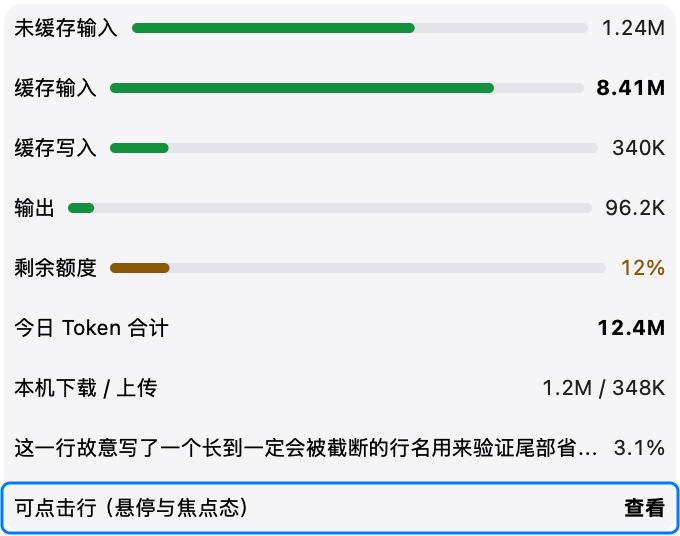
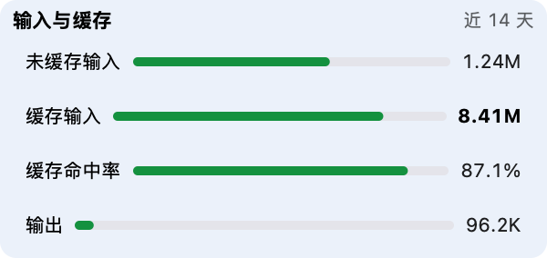

# 自绘组件库

> **何时阅读：** 新增面板 UI、评估「要不要为一行建视图」、或改动 `Sources/NetworkMonitor/DrawnUI/` 时。

## 为什么做

面板的内存主体不是业务数据（0.03 MB），而是**视图数量**：一个 AutoLayout 视图连同它的布局记录、
文本排版缓存、图层属性，真实成本约 **70 KB/行**；换成「一个视图直接画完一行」后约 **13 KB/行**。

同一视觉规格的对照实验（`/tmp` 独立基准，400 行）：

| 实现 | footprint | heap 节点 | 构建+布局 |
|------|-----------|-----------|-----------|
| AppKit 视图树（背景 + 2 个 NSTextField + 进度条 + 约束） | 38 MiB | 21.6 万 | 280.7 ms |
| 单视图自绘（CoreText 画字 + CGContext 画条） | **15 MiB** | **3.4 万** | **10.0 ms** |

外部对照（同为 Swift + AppKit 的菜单栏应用）：[osx_stats_nano](https://github.com/hefeicoder/osx_stats_nano)
纯 AppKit 自绘，实测 footprint **13 MiB**；我们改前面板 1159 个视图时是 91 MiB。

离屏样例（`NM_DRAWN_PROBE` 渲染，2 倍图）：





## 分层

自绘组件库按「口径 → 原语 → 组件 → 交互 → 面板」五层组织，**依赖方向单向向下**：
上层可以调下层，下层不 import 上层；能在下层说清的口径，不写在视图里。

| 层 | 放什么 | 判据（什么放这一层） | 位置 |
|----|--------|----------------------|------|
| **L1 口径** | 纯值类型与纯函数：几何、命中、状态推进、宽度分配、文案拼接、换算系数 | 能在 `TestRunner` 里 `assertEqual`，不需要 AppKit / 窗口 / 视图 | `NetworkMonitorUI/` |
| **L2 原语** | 一次落笔的最小绘制单元：圆角底/叠色/描边、进度条、色点、符号、文字、阴影、焦点环 | 只吃「矩形 + 颜色 + 值」；不持有业务状态、不认识业务类型 | `DrawnUI/` 的 `DrawnInk` / `DrawnCardSurface` / `DrawnCardShadow` / `DrawnFocusRing` / `DrawnSymbolRun` / `DrawnTextRun` / `DrawnTextBlock` |
| **L3 组件** | 有形状约定的组合单元：行列表、卡片、读数条、额度格 | 有自己的排布规则与可配置项（行高 / 列宽 / 卡头），但仍不知道面板业务 | `DrawnUI/DrawnRowList` · `DrawnCard` · `DrawnReadoutRun` · `MenuPanel/DrawnBillingCell` |
| **L4 交互** | 悬停目标推进、过渡值、焦点环、无障碍上报 | 跟「用户此刻的指针与键盘」有关，跟业务数据无关 | `NetworkMonitorUI/DrawnHoverState` · `DrawnUI/DrawnBlend` · `DrawnAccessibilityReporter` · `DrawnFocusRing` |
| **L5 面板** | 具体页面：系统页五卡 / 网络页 / Token 四屏 / 剪贴板卡流 / 额度页 | 只有这一层认识 `CPUSnapshot` / `HarnessUsageSnapshot` / `ClipboardItem` / `BillingProvider` | `MenuPanel/` · `Clipboard/` |

判据的两条推论：

- **同一个能力被第二处用到时，先下沉再接入**：交互能力（悬停 / 焦点环 / 无障碍 / 命中）原本在行列表、系统页五卡、剪贴板卡片各写一遍，本轮全部下沉到 L1（可断言）+ L4（唯一实现），三处只留接入调用；
- **落笔与算术分开**：算术（层不透明度折叠、阴影不透明度反算、焦点环内缩）一律进 L1，绘制里只剩「把算好的值喂给 CGContext」，改参数不会在三处漂移。

## 三处重复能力的唯一入口

| 能力 | 唯一实现（L1 / L4） | 三个接入点 |
|------|--------------------|-----------|
| 区域命中 | `DrawnHitRegions`（等步行带 / 优先级查表 / 单矩形） | `DrawnRowList.rowIndex(at:)` · `SystemCardView.mouseDown`（卡头按钮优先于整卡） · `ClipboardCardHitTest.region(at:)`（星标 / 角标优先于正文） |
| 悬停目标推进 | `DrawnHoverState`（进入 / 离开 / 跨行 / 越界归零） | `DrawnRowList.advanceHover` · `SystemCardView`（卡片无悬停高亮，只有焦点环） · `ClipboardCardView.applyHover` |
| 过渡值 | `DrawnBlend` + `MotionKit` | 行列表悬停淡入淡出 · 剪贴板 hover / 选中 / 缩略图 / 星标 / 角标 |
| 焦点环 | `DrawnFocusRing`（`DrawnFocusRingMath` 给路径口径） | 行列表 `drawFocusRing` · `SystemCardView.drawFocusRing` |
| 无障碍上报 | `DrawnAccessibilityReporter`（卡级单元素 / 子元素多元素）+ `DrawnAccessibilityText`（行文案） | 行列表逐行元素 · 系统卡卡头按钮 + 内容读数 · 剪贴板卡片级单元素 |
| 符号绘制 + 缓存 | `DrawnSymbolRun`（`DrawnSymbolCacheKey` 给键口径） | 行前图标（进程榜，模板图上色）· 剪贴板类型图标 / 收藏星 / 图片占位 · 剪贴板空态符号 |
| 卡片表面 | `DrawnCardSurface`（圆角 / 填充 / 叠色 / 描边 + 层不透明度） | `DrawnCard` 卡底 · `SystemCardView` 语义 wash 卡底 · 剪贴板卡片卡底 + hover / 选中两层 |
| 卡片阴影 | `DrawnCardShadow`（`DrawnShadowMath` 给换算） | 剪贴板卡片流容器（其余两处无投影，是设计如此） |

## 组件清单

| 类型 | 文件 | 职责 |
|------|------|------|
| `DrawnInk` | `DrawnUI/DrawnUIKit.swift` | 绘制原语：圆角路径、进度条、圆点、圆角底、1pt 分隔线 |
| `DrawnTextMeasurer` | `DrawnUI/DrawnTextRun.swift` | 文本测量缓存（按 字符串+字体+宽度上限），避免每帧走 CoreText |
| `DrawnTextRun` | 同上 | 一段文字的值类型：测量 + 绘制 + 截断 |
| `DrawnRowSpec` / `DrawnRowLayout` | `NetworkMonitorUI/DrawnRowSpec.swift` | 行规格（纯数据）+ 宽度分配与总高（纯计算，可断言） |
| `DrawnRowList` | `DrawnUI/DrawnRowList.swift`（绘制在 `+Drawing`） | **一个视图画 N 行**：单行式 / 两行式、行前图标、悬停高亮（淡入淡出）、点击、键盘焦点环、无障碍元素；交互全部走 L1 / L4 |
| `DrawnSingleRowStyle` | `DrawnUI/DrawnRowStyle.swift` | 单行式一行的样式值类型 + 绘制本身；行列表与整卡自绘共用同一段绘制，保证画出来一模一样 |
| `DrawnReadoutRun` | `DrawnUI/DrawnReadoutRun.swift` | 横向读数条：文字 / 色块 / 圆点 / 细条 / 环 混排，组内与组间两级间距，一次 draw 画完整条 |
| `SystemCardView` | `MenuPanel/SystemPaneView+CardView.swift` | 整卡自绘基类：卡底 wash + 卡头（标题 / 附属件 / 说明 / 「›」）+ 内容区钩子；卡内零子视图，整卡可点、可聚焦、可读屏 |
| `SystemCardLayout` | `NetworkMonitorUI/SystemCardLayout.swift` | 五卡的纯口径：卡头三栏让位 / 卡高与内容区 / 读数条排布 / 堆叠段宽 / 负载纵轴 / 取整合账（可断言） |
| `SystemChartDrawing` | `MenuPanel/SystemChartDrawing.swift` | 卡片与二级详情页共用的图形绘制：面积图 / 折线 / 环 / 堆叠条 / 迷你曲线 |
| `DrawnCard` | `DrawnUI/DrawnCard.swift` | 卡片：卡头标题 + 右侧说明 + 行列表（1 容器 + 1 列表） |
| `DrawnBillingCell` | `MenuPanel/DrawnBillingCell.swift` | 额度格：数值 + 单位（共基线）+ 名称 + 3pt 进度条 + 角标 / 重置时间 |
| `DrawnTextBlock` | `DrawnUI/DrawnTextBlock.swift` | 多行文本块：断行测量（缓存）+ 行数封顶 + 垂直居中 + 尾部省略，用于卡片正文 |
| `DrawnBlend` | `DrawnUI/DrawnBlend.swift` | 自绘过渡值：按 MotionKit 的时长与曲线逐帧推进 0…1 混合系数，驱动重绘（行列表悬停淡入淡出 / 剪贴板的 hover / 选中 / 缩略图淡入 / 星标与角标弹入） |
| `DrawnHitRegions` | `NetworkMonitorUI/DrawnHitRegions.swift` | 区域命中：等步行带（含边缘 / 排除空隙）/ 优先级查表 / 单矩形（L1，可断言） |
| `DrawnHoverState` | `NetworkMonitorUI/DrawnHoverState.swift` | 悬停目标推进：进入 / 离开 / 跨行 / 越界归零，输出 `blendTarget`（L1，可断言） |
| `DrawnLayerAlpha` / `DrawnShadowMath` / `DrawnFocusRingMath` | `NetworkMonitorUI/DrawnSurfaceMath.swift` | 绘制层的换算式：层不透明度折叠 / 阴影不透明度反算与模糊核 / 焦点环内缩与圆角（L1） |
| `DrawnSymbolCacheKey` | `NetworkMonitorUI/DrawnSymbolCacheKey.swift` | 符号图缓存键（符号名 + 点尺寸取整 + 着色描述）（L1） |
| `DrawnAccessibilityText` | `NetworkMonitorUI/DrawnAccessibilityText.swift` | 自绘行读屏文案：四段拼接、空段不念（L1） |
| `DrawnCardSurface` | `DrawnUI/DrawnCardSurface.swift` | 卡片表面：圆角 / 填充 / 叠色 / 描边 + 层不透明度，三处卡片共用（L2） |
| `DrawnCardShadow` | `DrawnUI/DrawnCardShadow.swift` | 卡片阴影：容器层按圆角矩形绘制，参数化 opacity / blur / offset / 内容 alpha（L2） |
| `DrawnFocusRing` | `DrawnUI/DrawnFocusRing.swift` | 焦点环：行内（1.5pt / 内缩 1,1.5）与整卡（2pt / 内缩 1）两种（L2） |
| `DrawnSymbolRun` | `DrawnUI/DrawnSymbolRun.swift` | 符号绘制 + 缓存：模板图按 tint 上色并等比缩放（行图标）、SF Symbol 按 palette 着色并按自身尺寸居中（L2） |
| `DrawnAccessibilityReporter` | `DrawnUI/DrawnAccessibilityReporter.swift` | 自绘元素上报：卡级单元素 / 子元素多元素两种模式 + 元素 frame 换算（L4） |
| `ClipboardCardGeometry` / `ClipboardCardHitTest` | `NetworkMonitorUI/ClipboardCardGeometry.swift` | 剪贴板卡片的纯口径：内容区 / 正文区 / meta 行 / 星标 / 角标位置 + 命中区域与动作（可断言） |
| `BillingCellLayout` | `NetworkMonitorUI/BillingCellLayout.swift` | 额度格的纯口径：告警分级、角标拼接、角标行数（可断言） |

## 用法

```swift
let card = DrawnCard()
card.title = "输入与缓存"
card.caption = "近 14 天"
card.list.rowSpacing = 2
card.list.rows = [
    DrawnRowSpec(title: "未缓存输入", value: "1.24M", progress: 0.62),
    DrawnRowSpec(title: "缓存输入", value: "8.41M", progress: 0.81, tone: .strong),
    DrawnRowSpec(title: "剩余额度", value: "12%", progress: 0.12, tone: .warning),
]
card.list.onRowAction = { index in /* 点击某行 */ }
card.list.focusedIndex = 2   // 键盘焦点
```

宽度分配由 `DrawnRowLayout.metrics` 统一决定：**数值优先不被截断 → 行名按实测宽度占位 → 剩余才给进度条 →
剩余不足 `minBarWidth`（默认 60）时整条进度不画**，避免长标题后面挂一个小色块。

### 行前图标（进程榜）

```swift
list.iconSize = 20
list.iconTint = MenuPanelStyle.tertiaryText        // 模板图（SF Symbol 占位）上色，按图标对象缓存
list.rowIcon = { index in AppIconProvider.icon(forProcess: procs[index].name,
                                              pid: procs[index].pid, size: 20) }
```

图标列始终占位（这行取不到图标也留空），行名左对齐才整齐；`DrawnRowLayout` 会先扣掉 `iconSize + gap` 再分配宽度。

### 两行式行（排行 / 分布）

```swift
list.rowSpacing = 2
list.rowHeight = 48                              // 由宿主按可见行数均分后设置
list.detailFont = TokenPaneStyle.noteFont
list.rows = rows.map {
    DrawnRowSpec(title: $0.name, value: $0.amount, progress: $0.share,
                 detail: metaText($0), secondary: percent($0.share), showsSwatch: true)
}
list.rowSwatchColor = { TokenPaneStyle.distroColor(rows[$0].colorIndex) }   // 色点与底部微条同色
```

两行式第一行是「色点 + 行名 + 值 + 次列（右对齐）」，第二行副文本，底部整行微条；配色点与微条同源，
一眼能对上行列。列宽计算在 `stackedHeadMetrics`，绘制与快照台账共用同一份，不会「量一套画另一套」。

## 边界：什么不自绘

| 保留原生 | 原因 |
|----------|------|
| `NSSearchField` / `NSTextField`（可编辑） | 输入法、选区、撤销、粘贴链路自绘成本远高于收益 |
| `NSScrollView` | 弹性滚动、滚动条、手势，全应用只留一个 |
| `NSPopover` / `NSWindow` / `NSMenu` | 窗口服务器合成，自绘没有替代品 |
| 快捷键录制、系统权限引导 | 依赖系统交互 |

## 已接入

| 位置 | 改造前视图数 | 现在 | 快照核对 |
|------|--------------|------|----------|
| 系统页进程榜（Top-2 / Top-10） | 10 行 × 4 ≈ 41 | 1 | 逐项一致（此前一轮） |
| 网络页活跃进程 Top5 | 5 行 × 5 ≈ 26 | 1 | 320×511 逐像素一致（diff bbox 为空） |
| Token 排行屏 Top-8 | 8 行 × 6 ≈ 50 + 栈 | 1 | 占比条 / 微条 / 行高与改造前一致，台账 truncated 全 NO |
| 额度格（每 provider 1–3 格） | 每格 7 + 1 栈 | 每格 1 | 卡片内元素位置与字号一致；整页高 +4pt（每格行高取整 +1pt） |
| 系统页首屏五卡 + 20pt 状态带 | 113（连状态带 132） | 0（含容器 6） | 320×480 逐像素：差异 5114px / 3.33%，全部落在文字抗锯齿边缘（最佳位移 = 0，图形零差异）；五卡 frame 与改造前逐项相同 |
| 剪贴板卡片流（32 张卡片视图池） | 卡片区 288（面板总计 430） | 卡片区 0（面板总计 142） | 640×260 首帧对照：差异 10557px / 6.34%；差异集中在选中卡叠色（每像素 1–2 级）、星标符号（约 500px / 卡）、卡片与占位块 1px 轮廓；文本卡正文与 meta 文字逐像素一致（第 3 张卡仅 110px），阴影由卡片流容器绘制后与改造前几乎重合 |

## 验收方式

- 纯逻辑：`TestRunner` 的 `runDrawnRowLayoutTests`（宽度分配 / 总高 / 值类型语义）与 `runSystemCardLayoutTests`（卡头让位 / 卡高与内容区 / 读数条 / 段宽 / 负载纵轴 / 取整合账）
- 交互层纯口径：`runDrawnInteractionTests`（等步行带边缘与空隙 / 区域优先级 / 悬停进入-跨行-越界归零）
- 绘制层算术：`runDrawnSurfaceMathTests`（层不透明度折叠 / 阴影不透明度反算与模糊核 / 焦点环内缩 / 符号缓存键 / 读屏文案）
- 交互自证（真实视图）：`NM_DRAWN_INTERACTION_PROBE=<目录>` 出 `drawn-interaction-probe.txt` + 行列表（悬停 / 焦点环）与系统卡（焦点环）绘制图；剪贴板卡片用 `NM_CLIPBOARD_CARD_PROBE=<目录>`（命中 / 右键五项 / 无障碍 / 选中 / hover 推进 + 悬停态绘制图）
- 悬停全文浮层：`NM_CLIPBOARD_OVERLAY_PROBE=<目录>` 在真实 `NSPanel` 上验四件事——0.45 s 前不出现、0.45 s 后出现（宽度 280 / 正文封顶 9 行 / `ignoresMouseEvents`）、移出即收、滚轮由浮层消费（内部 `NSScrollView` 的 clip 位移变化，不落到卡片流）；产出 `clipboard-overlay-probe.txt` + 浮层绘制图。它证的是「进程内真实控件状态」，屏幕上是否肉眼可见仍需人看一眼
- 视觉：`NM_DRAWN_PROBE=<目录>` 渲染离屏样例（`drawn-rowlist.png` / `drawn-card.png`），
  需打包成 `.app` 后跑包内可执行文件（见踩坑「快照取证需打包成 app」）
- 无障碍：自绘行必须在 `accessibilityChildren()` 里上报（role / label / frame），可点击行实现 `accessibilityPerformPress`

## 已知限制

- 目前只有「行」和「卡片」两种单元；**分区标题、状态带尚未组件化**，仍用 AppKit 实现。图表已自绘（`SystemChartDrawing` / `MenuPanelCharts`），但没有统一到组件层。
- 剪贴板卡片的**卡内文字排版**（正文断行 / meta 行排布）仍留在卡片自己的 `+Content` 里，没有下沉成组件：它只服务这一种卡片，抽出去反而多一层间接。
- 自绘不支持文本选择、富文本内联编辑（面板里当前没有这类需求）。
- 行高默认取令牌值（`PaneCardStyle.rowHeight`）；两行式由宿主给（如排行屏 34…48 自适应），尚未支持「行内自动变高」。
- 自绘行不参与系统的文本选择与右键菜单，需要这两项的行仍走视图树。
- **卡片阴影不能画在卡片自己的 `draw` 里**：视图绘制被 bounds 裁切，画不到卡外；而卡片自身 backing layer 的阴影在离屏快照（`cacheDisplay`）路径里不参与合成。剪贴板卡片流因此把 hover / 选中投影交给容器（`ClipboardCardFlowContainer`）调 `DrawnCardShadow` 按圆角矩形统一绘制（`CGContext.setShadow`，blur 取 `shadowRadius × 2` 才对得上 CA 阴影的扩散跨度）。
- 自绘符号图标（SF Symbol）与改造前 `NSImageView` 的渲染有 1px 级差异：同一 12pt 星形，自绘的黄色像素比原生多约 20%（约 500px / 卡）。形位一致，差异在符号位图插值。
- 自绘文字走 CoreText 灰度抗锯齿，与原生 `NSTextField` 的次像素渲染有 1px 级的边缘深浅差：系统页首屏快照比对为 3.33%（5114px / 320×480）、最大通道差 195/255、最佳位移 = 0（字形与位置一致，只有边缘）。
  带 alpha 的文字色会因此偏浅，已由 `SystemCardView.labelText` 统一折算「原生标签等效色」，卡内各处不再各自处理。
- 增量构建偶尔漏重新链接库目标：改完 `NetworkMonitorUI` 里的纯逻辑后，建议用探针图或诊断输出确认改动真的生效。