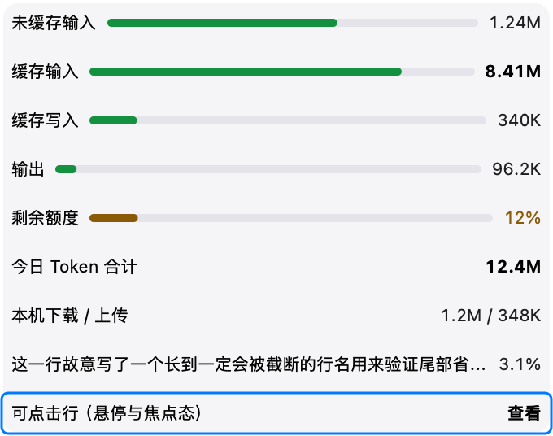
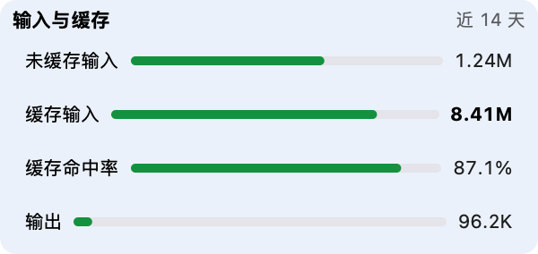

# 自绘组件库

> **何时阅读：** 新增面板 UI、评估「要不要为一行建视图」、或改动 `Sources/NetworkMonitor/DrawnUI/` 时。

## 为什么做

面板的内存主体不是业务数据（0.03 MB），而是**视图数量**：一个 AutoLayout 视图连同它的布局记录、
文本排版缓存、图层属性，真实成本约 **70 KB/行**；换成「一个视图直接画完一行」后约 **13 KB/行**。

同一视觉规格的对照实验（`/tmp` 独立基准，400 行）：

| 实现 | footprint | heap 节点 | 构建+布局 |
|------|-----------|-----------|-----------|
| AppKit 视图树（背景 + 2 个 NSTextField + 进度条 + 约束） | 38 MiB | 21.6 万 | 280.7 ms |
| 单视图自绘（CoreText 画字 + CGContext 画条） | **15 MiB** | **3.4 万** | **10.0 ms** |

外部对照（同为 Swift + AppKit 的菜单栏应用）：[osx_stats_nano](https://github.com/hefeicoder/osx_stats_nano)
纯 AppKit 自绘，实测 footprint **13 MiB**；我们改前面板 1159 个视图时是 91 MiB。

离屏样例（`NM_DRAWN_PROBE` 渲染，2 倍图）：





## 组件清单

| 类型 | 文件 | 职责 |
|------|------|------|
| `DrawnInk` | `DrawnUI/DrawnUIKit.swift` | 绘制原语：圆角路径、进度条、圆点、圆角底、1pt 分隔线 |
| `DrawnTextMeasurer` | `DrawnUI/DrawnTextRun.swift` | 文本测量缓存（按 字符串+字体+宽度上限），避免每帧走 CoreText |
| `DrawnTextRun` | 同上 | 一段文字的值类型：测量 + 绘制 + 截断 |
| `DrawnRowSpec` / `DrawnRowLayout` | `NetworkMonitorUI/DrawnRowSpec.swift` | 行规格（纯数据）+ 宽度分配与总高（纯计算，可断言） |
| `DrawnRowList` | `DrawnUI/DrawnRowList.swift`（绘制在 `+Drawing` / `+Icon`） | **一个视图画 N 行**：单行式 / 两行式、行前图标、悬停高亮、点击、键盘焦点环、无障碍元素 |
| `DrawnCard` | `DrawnUI/DrawnCard.swift` | 卡片：卡头标题 + 右侧说明 + 行列表（1 容器 + 1 列表） |
| `DrawnBillingCell` | `MenuPanel/DrawnBillingCell.swift` | 额度格：数值 + 单位（共基线）+ 名称 + 3pt 进度条 + 角标 / 重置时间 |
| `BillingCellLayout` | `NetworkMonitorUI/BillingCellLayout.swift` | 额度格的纯口径：告警分级、角标拼接、角标行数（可断言） |

## 用法

```swift
let card = DrawnCard()
card.title = "输入与缓存"
card.caption = "近 14 天"
card.list.rowSpacing = 2
card.list.rows = [
    DrawnRowSpec(title: "未缓存输入", value: "1.24M", progress: 0.62),
    DrawnRowSpec(title: "缓存输入", value: "8.41M", progress: 0.81, tone: .strong),
    DrawnRowSpec(title: "剩余额度", value: "12%", progress: 0.12, tone: .warning),
]
card.list.onRowAction = { index in /* 点击某行 */ }
card.list.focusedIndex = 2   // 键盘焦点
```

宽度分配由 `DrawnRowLayout.metrics` 统一决定：**数值优先不被截断 → 行名按实测宽度占位 → 剩余才给进度条 →
剩余不足 `minBarWidth`（默认 60）时整条进度不画**，避免长标题后面挂一个小色块。

### 行前图标（进程榜）

```swift
list.iconSize = 20
list.iconTint = MenuPanelStyle.tertiaryText        // 模板图（SF Symbol 占位）上色，按图标对象缓存
list.rowIcon = { index in AppIconProvider.icon(forProcess: procs[index].name,
                                              pid: procs[index].pid, size: 20) }
```

图标列始终占位（这行取不到图标也留空），行名左对齐才整齐；`DrawnRowLayout` 会先扣掉 `iconSize + gap` 再分配宽度。

### 两行式行（排行 / 分布）

```swift
list.rowSpacing = 2
list.rowHeight = 48                              // 由宿主按可见行数均分后设置
list.detailFont = TokenPaneStyle.noteFont
list.rows = rows.map {
    DrawnRowSpec(title: $0.name, value: $0.amount, progress: $0.share,
                 detail: metaText($0), secondary: percent($0.share), showsSwatch: true)
}
list.rowSwatchColor = { TokenPaneStyle.distroColor(rows[$0].colorIndex) }   // 色点与底部微条同色
```

两行式第一行是「色点 + 行名 + 值 + 次列（右对齐）」，第二行副文本，底部整行微条；配色点与微条同源，
一眼能对上行列。列宽计算在 `stackedHeadMetrics`，绘制与快照台账共用同一份，不会「量一套画另一套」。

## 边界：什么不自绘

| 保留原生 | 原因 |
|----------|------|
| `NSSearchField` / `NSTextField`（可编辑） | 输入法、选区、撤销、粘贴链路自绘成本远高于收益 |
| `NSScrollView` | 弹性滚动、滚动条、手势，全应用只留一个 |
| `NSPopover` / `NSWindow` / `NSMenu` | 窗口服务器合成，自绘没有替代品 |
| 快捷键录制、系统权限引导 | 依赖系统交互 |

## 已接入

| 位置 | 改造前视图数 | 现在 | 快照核对 |
|------|--------------|------|----------|
| 系统页进程榜（Top-2 / Top-10） | 10 行 × 4 ≈ 41 | 1 | 逐项一致（此前一轮） |
| 网络页活跃进程 Top5 | 5 行 × 5 ≈ 26 | 1 | 320×511 逐像素一致（diff bbox 为空） |
| Token 排行屏 Top-8 | 8 行 × 6 ≈ 50 + 栈 | 1 | 占比条 / 微条 / 行高与改造前一致，台账 truncated 全 NO |
| 额度格（每 provider 1–3 格） | 每格 7 + 1 栈 | 每格 1 | 卡片内元素位置与字号一致；整页高 +4pt（每格行高取整 +1pt） |

## 验收方式

- 纯逻辑：`TestRunner` 的 `runDrawnRowLayoutTests`（宽度分配 / 总高 / 值类型语义）
- 视觉：`NM_DRAWN_PROBE=<目录>` 渲染离屏样例（`drawn-rowlist.png` / `drawn-card.png`），
  需打包成 `.app` 后跑包内可执行文件（见踩坑「快照取证需打包成 app」）
- 无障碍：自绘行必须在 `accessibilityChildren()` 里上报（role / label / frame），可点击行实现 `accessibilityPerformPress`

## 已知限制

- 目前只有「行」和「卡片」两种单元；**分区标题、图表、状态带尚未组件化**，仍用 AppKit 实现。
- 自绘不支持文本选择、富文本内联编辑（面板里当前没有这类需求）。
- 行高默认取令牌值（`PaneCardStyle.rowHeight`）；两行式由宿主给（如排行屏 34…48 自适应），尚未支持「行内自动变高」。
- 自绘行不参与系统的文本选择与右键菜单，需要这两项的行仍走视图树。
- 增量构建偶尔漏重新链接库目标：改完 `NetworkMonitorUI` 里的纯逻辑后，建议用探针图或诊断输出确认改动真的生效。