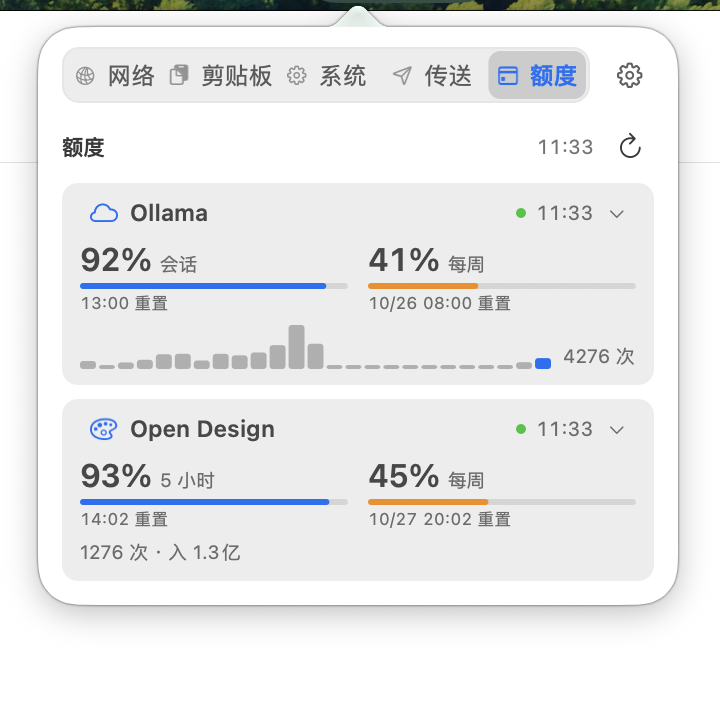
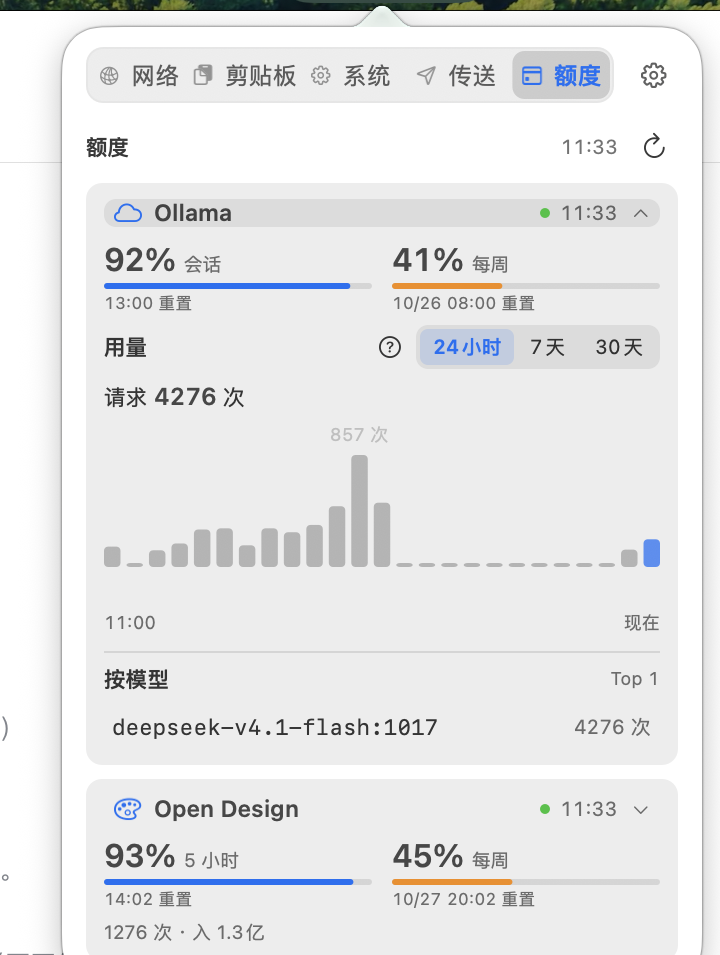

# 额度页聚合视图设计规格

> **何时阅读：** 修改「额度」tab 的布局、多 provider 展示或额度页数据层时。

## 背景

原实现一次只显示一个 provider（点页头名称弹出切换菜单），第二个 provider 入口极不显眼——用户实测反馈「不知道还有 Open Design」。
320pt 浮层里每个限额仍占 3 行（标题 / 进度条 / 重置时间），两个 provider 全量展开需要 470pt 以上。

## 目标

1. **一屏看全**：所有已注册 provider 的额度关键数字同时可见，不需要切换。
2. **密度**：单个 provider 的额度区压缩到约 100pt（双列并排限额 + 大号等宽百分比）。
3. **图表不缺席**：收起态每个 provider 带一条 22pt 迷你趋势图，点开后换成完整柱状图 + 范围切换 + 模型明细。

## 信息架构

```
额度                                  11:16  ↻      ← 页头（全局时间与刷新）
┌─ provider 块（按注册顺序）────────────────────┐
│ ☁ Ollama               ● 11:16  ⌄            │
│  95% 会话        42% 每周                    │  ← 双列：百分比 + 标签
│  ▓▓▓▓▓▓▓▓░       ▓▓▓▓░░░░░                  │  ← 3pt 进度条
│  13:00 重置      10/26 08:00                │  ← 重置时间（8.5pt）
│  ▁▂▃▅▇█▅▃▂▁▁▂▃   4,169 / 24h 请求          │  ← 迷你趋势 + 摘要
└──────────────────────────────────────────────┘
```

点块标题行就地展开：迷你图替换为完整柱状图（46pt）+ 范围按钮 + 模型明细；同一时刻最多展开一个。

## 数据层改造（BillingMonitor）

原快照只有一个 `balance` / `usage`，对应单一 `selectedProviderID`。改为**每个 provider 一份独立状态**：

```swift
struct ProviderState {
    let descriptor: ProviderDescriptor
    var range: BillingRange          // 每个 provider 独立选择范围
    var isConfigured: Bool
    var balance: BillingBalance?
    var usage: BillingUsage?
    var lastUpdated: Date?
    var isLoading: Bool
    var errorMessage: String?
}

struct Snapshot { var states: [ProviderState] }
```

刷新语义：

| 场景 | 行为 |
|------|------|
| tick（每秒） | 60 秒节流内直接返回；超时则对**所有已配置 provider** 并发拉取 |
| 打开面板 / 点刷新 | `force: true` 跳过节流，全部重拉 |
| 切换某块的范围 | 只重拉该 provider 的 usage，保留 balance（避免打满 10 次/分钟限流） |
| 未配置凭据 | 不发起请求，`isConfigured = false`，块内显示配置入口 |
| 429 | 全局退避到 `retryNotBefore`，期间不请求但仍回报快照 |
| 屏幕暂停 | 同原有行为：不请求，但回报一次快照避免面板空白 |

并发：2 provider × (balance + usage) = 4 个请求，`async let` 并行；`generation` 计数丢弃过期结果。

## 图表能力差异

`supportsTimeSeries = false` 的 provider（Open Design）**不画趋势图**——它只给全范围汇总，逐桶请求会触发限流。
该情况下块内右侧摘要改为显示请求数与 token 汇总，展开区显示分组明细（`supportsModelBreakdown`）。

## 视觉要点

| 元素 | 规格 |
|------|------|
| provider 块 | 背景 `surface`，圆角 9pt，内边距 7/9pt |
| 百分比 | `monospacedDigitSystemFont(16, .semibold)`，与标签同行 baseline 对齐 |
| 进度条 | 高 3pt，圆角 2pt；剩余 < 50% 用橙色，< 20% 用红色 |
| 迷你趋势 | 高 22pt，柱宽自适应，最后一根用强调色 |
| 重置时间 | 8.5pt 等宽，三级文字色 |
| 展开指示 | `chevron.down` / `chevron.up`，9pt |

## 交互

- 点块标题行：展开 / 收起该 provider（同时只允许一个展开）。
- 展开区内范围按钮：只影响该 provider。
- 未配置块：点「配置」展开凭据输入（复用 `BillingCredentialSetupView`）。
- 键盘可达行顺序：块 1 标题 → 块 1 范围按钮 → … → 刷新。

## 实机预览

| 收起态 | 展开态 |
|---|---|
|  |  |

## 验收

1. 两个 provider 在 320×520 内一屏可见（无滚动）。
2. 收起态每块可见：名称、两条额度百分比与进度条、重置时间、用量摘要（有分桶时带迷你趋势）。
3. 展开态可见完整柱状图与模型明细，范围切换只刷新该 provider。
4. 未配置凭据的 provider 显示配置入口，不显示空图表。
5. 深色模式下所有色值跟随系统语义色。